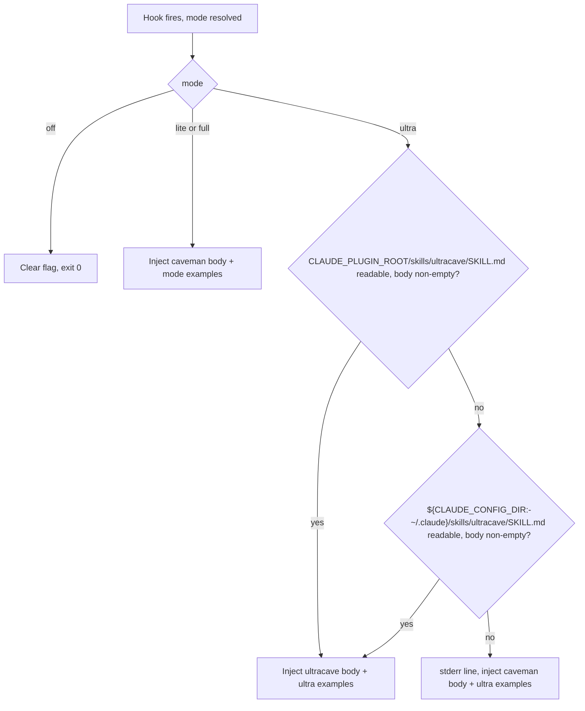
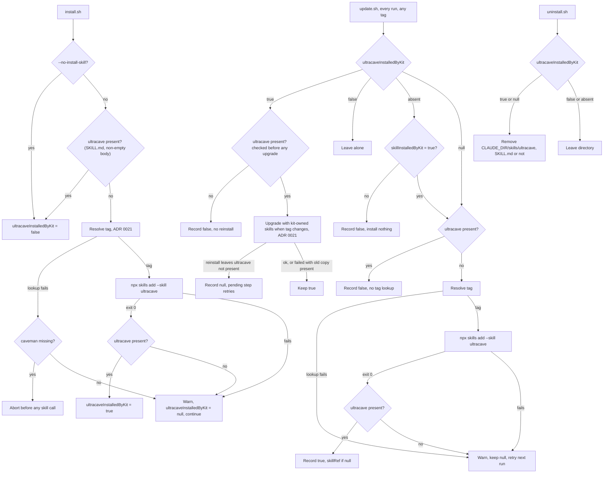

# ADR 0020: Onboard the upstream `ultracave` skill for `ultra` mode

**Status:** Accepted. Amends ADR 0001 (install scope), ADR 0003 (manifest and uninstall) and ADR 0006 (wenyan fallback).

**Context:**

Upstream moved the ultra rules out of `caveman/SKILL.md` and into a separate `ultracave` skill at v3.1.0. The v3.0.0 to v3.2.0 pin bump crossed that split and the kit never adapted. Two things broke without any error (`docs/research/2026-10-29-ultracave-alias-and-ultra-mode.md`):

- `hooks/caveman-activate.js` filters the injected skill by intensity-table row. v3.1.0 removed the table, so the filter finds no rows. `lite`, `full` and `ultra` all receive the same caveman rules and differ only by the kit's example lines in `hooks/caveman-examples.md`.
- `install.sh` and `update.sh` install `--skill caveman` only. The slash-command path loads `caveman/SKILL.md`, which tells the model to follow `ultracave`. That skill is not installed.

`ultracave` is a different ruleset, not a longer caveman. It strips articles, copulas and connectives, prefers one word where one word is enough, and states each fact once. It drops caveman's ASD-STE100 sentence cap and its answer-first and short-word rules. It ships `disable-model-invocation: true`, so only the user can invoke it.

Two other fixes were considered: a kit-authored ultra supplement, and bumping the pin. The supplement would add kit-written rule text of the kind ADR 0019 reverted, and would diverge from upstream's definition of ultra. A pin bump does not help: upstream `main` has no changes to either skill.

**Decision:**

1. **Install `ultracave` with `caveman`, one call per missing skill.** `install.sh` runs a separate `npx skills add` call for each skill it installs, so a failure is attributed to one skill. Both calls use the ref resolved by ADR 0021. The cases are:

   | `caveman` | `ultracave` | `--no-install-skill` | Kit installs | `skillInstalledByKit` | `ultracaveInstalledByKit` |
   |---|---|---|---|---|---|
   | missing | missing | no | `--skill caveman`, then `--skill ultracave` | `true` | `true` |
   | present | missing | no | `--skill ultracave` only | `false` | `true` |
   | missing | present | no | `--skill caveman` only | `true` | `false` |
   | present | present | either | nothing | `false` | `false` |
   | present | missing | yes | nothing | `false` | `false` |
   | missing | any | yes | nothing; abort (ADR 0001 decision 4) | n/a | n/a |

   `ultracave` is installed whenever it is missing and `--no-install-skill` is not set, including when `caveman` is user-managed.

   `ultracave` is **present** only when `$CLAUDE_DIR/skills/ultracave/SKILL.md` is readable and has a non-empty body after frontmatter. A directory without such a file counts as missing in every step: the install decision, the post-install check, and the `null` branch of decision 7.

   Before the first skill call, `install.sh` resolves the tag (ADR 0021). A failed lookup is handled by decision 6. After a zero-exit `--skill ultracave` call, `install.sh` checks that `ultracave` is present. If it is not, the call counts as failed (decision 6). Verified on 2026-10-29 with `skills` CLI at `v4.0.1`, in a temporary `HOME`: a single call with repeated `--skill caveman --skill ultracave` installs both, and a call over a partial `skills/ultracave/` (no `SKILL.md`) overwrites it and exits 0.

   Assumption: later CLI versions also overwrite a partial directory. The kit does not delete it first. Fallback if a later CLI refuses: the call fails, the flag stays `null`, the warning prints the manual command, and decision 5 keeps `ultra` working.
2. **Ownership is tracked per skill.** The manifest gains `ultracaveInstalledByKit`, with three values:
   - `true`: the kit installed `ultracave` and owns it.
   - `false`: the kit does not own it (pre-existing skill, `--no-install-skill`, or a legacy manifest with `skillInstalledByKit: false`, decision 7).
   - `null`: the kit should own it but it is not present (failed install, decision 6, or a failed upgrade reinstall, decision 7). `null` means pending: every `update.sh` run retries it (decision 7).

   The kit records `true` only after it verified `ultracave` present following its own last write. A `true` flag therefore always means a state the kit left healthy.

   `uninstall.sh` removes `$CLAUDE_DIR/skills/ultracave/` when the value is `true` or `null`, whether or not `SKILL.md` is still in it. Under `null` any directory there is kit-created: `null` means the kit tried to install it, and a skill present beforehand would have been recorded `false`. `false` and an absent field leave the directory alone. A pre-existing `ultracave` is never touched.
3. **No patch, no backup.** Upstream already sets `disable-model-invocation: true` on `ultracave`, so there is no frontmatter patch and no backup file. This differs from `caveman` (ADR 0002).
4. **`ultra` injects the `ultracave` body.** In `ultra` mode `caveman-activate.js` reads `ultracave/SKILL.md`, strips its frontmatter, and injects that body in place of the caveman body. The kit's `- ultra:` example lines are still appended. This applies to both SessionStart and SubagentStart. `lite` and `full` keep the caveman body. The `ultracave` body is injected unfiltered, because it is already a single mode and the row and wenyan filters exist only to select one mode from the caveman file. Only the kit's appended example lines are filtered, as before (only the `ultra` line is kept).
   - The hook reads `$CLAUDE_PLUGIN_ROOT/skills/ultracave/SKILL.md` first. `install.sh` derives `pluginRoot` by resolving symlinks on `skills/caveman`. When `caveman` is a real directory, that path is `$CLAUDE_DIR/skills/ultracave`, where `npx skills add -g` installs it.
   - When `caveman` is a symlink to another tree, the two roots differ. The hook then tries `${CLAUDE_CONFIG_DIR:-~/.claude}/skills/ultracave/SKILL.md` second.
   - `pluginRoot` depends on `skills/caveman` only. Installing or reinstalling `ultracave` never changes it, so it never requires a `settings.json` repatch. A `caveman` reinstall can change it; ADR 0021 decision 5 covers that case.
   - Assumption: `npx skills add -g` installs under `$CLAUDE_CONFIG_DIR/skills` (or `~/.claude/skills`), and the hook sees the same `CLAUDE_CONFIG_DIR`. Mitigation: the post-install presence check reads `$CLAUDE_DIR/skills/ultracave/SKILL.md`. A CLI that installs elsewhere therefore takes the `null` path, and the hook falls back (decision 5).
5. **Missing `ultracave` falls back.** If neither file is readable, or the body after frontmatter is empty, `ultra` falls back to the caveman body and writes one line to stderr. The hook still exits 0 (hooks-always-exit-0 invariant). A partial directory left by a failed install takes this path.
6. **Failure policy for the `ultracave` install.**
   - `install.sh`: a failed `caveman` call takes the existing abort path (ADR 0001 decision 4). A failed `ultracave` call does not abort. A zero-exit call that leaves `ultracave` not present (decision 1) counts as failed. It prints a warning with the manual command (pinned to the tag when one is known, else a placeholder plus the releases URL, ADR 0021 decision 7), records `ultracaveInstalledByKit: null`, and finishes the install. `ultra` uses the fallback in decision 5 until the skill arrives.
   - This holds when `caveman` is user-managed too. The user's `caveman` is never blocked by an `ultracave` failure.
   - A tag lookup failure aborts `install.sh` before any skill call only when `caveman` is missing, because the user needs it (ADR 0021 decision 7). When `caveman` is present and only `ultracave` is missing, the failure is soft: the same warning, `ultracaveInstalledByKit: null`, and the install finishes.
7. **Existing installs migrate on update.** `update.sh` resolves `ultracave` ownership on every run, independent of whether the resolved tag differs from `skillRef` (ADR 0021 decision 5). An unchanged `skillRef` never hides a pending `ultracave`. Legacy installs reach this step only on their second `update.sh` run (ADR 0021, Consequences: legacy installs migrate in two runs). The presence-based transitions below (legacy `false`, `null` with `ultracave` present, `true` with `ultracave` missing) run first, with no tag lookup. The lookup runs only when something must be installed or upgraded.
   - **Legacy manifest (field absent).** A legacy manifest does not record `--no-install-skill`. It cannot tell an opted-out user from a user-managed `caveman`. So the rule keys on `skillInstalledByKit`:
     - `skillInstalledByKit: true`: the kit owns `caveman`, so this is a kit-managed setup. `update.sh` sets the field to `null` and takes the `null` path below.
     - `skillInstalledByKit: false` (or absent): `update.sh` records `false` and installs nothing. This keeps every `--no-install-skill` user opted out. The cost: a user-managed `caveman` without `ultracave` gets no automatic install. Such a user installs `ultracave` with the manual command only. Re-running `install.sh` is no remedy: it refuses over a completed manifest.
   - **`null` (pending).**
     - If `ultracave` is present (decision 1), it records `false`. No tag is needed.
     - If it is missing, including a directory without a usable `SKILL.md`, it installs the skill at the resolved tag. It records `true` only when the call exits 0 and `ultracave` is then present. It writes `skillRef` only when `skillRef` is `null` (ADR 0021 decision 4). A tag upgrade that reinstalled no kit-owned skill leaves `skillRef` unchanged (ADR 0021 decision 6), so this rule can apply.
     - If the install, the presence check or the tag lookup fails, it prints a warning, keeps `null`, and finishes the update. The next run retries.
   - **`false`.** `update.sh` never installs `ultracave`. A `--no-install-skill` user therefore stays opted out.
   - **`true`.** If `ultracave` is missing, `update.sh` records `false` and does not reinstall it (decision 8). This check runs before any upgrade. Otherwise the skill moves with the kit-owned skills when the tag changes (ADR 0021 decision 6). `update.sh` checks presence after every reinstall attempt. If `ultracave` is not present, it records `null`, never keeps `true`; the pending step retries it, in the same run and every later run. If the call fails but the old `ultracave` is still present, the flag stays `true` and the next run retries the upgrade.
8. **Out of scope.** `megacave` is not installed (ADR 0006 still holds). A kit-owned `ultracave` (`true`) that the user deletes is not reinstalled: when `update.sh` finds `true` with `ultracave` missing, it records `false` before any upgrade, so the kit never reinstalls something the user removed. A failed kit write never leaves `true` (decisions 2 and 7), so `true` with `ultracave` missing can only be a user deletion. `ultracave` stays removed and `ultra` takes the decision 5 fallback. A manual `npx skills add` restores it. `lite` keeps its current behavior; it differs from `full` only by examples, which is a separate gap. The stale-backup concern from the research note is dropped: `uninstall.sh` deletes the whole `caveman` directory when the kit installed it, and restores the backup only for a user-managed skill, which `update.sh` never upgrades.
9. **No benchmark gate.** ADR 0008 and 0009 gate rule text the kit writes. `ultracave` is unmodified upstream text, so this restores upstream's design and does not add a kit-authored supplement. The kit's `- ultra:` example lines are kit-authored, and they are still appended (decision 4). They are not new: the same lines were injected before this change, so they need no new gate.
10. **Fixes in the same change.**
    - `update.sh` re-runs `lib/skill-patch.js` after it reinstalls `caveman` (ADR 0021 decision 6).
    - Tests cover each row of the decision 1 table, every `ultracaveInstalledByKit` value and transition (including a failed upgrade reinstall to `null`), the hook fallback, and each uninstall branch. The detailed list belongs in the implementation tickets.

Hook runtime:

Install, update and uninstall ownership of `ultracave` (`caveman` keeps its existing branches):

**Consequences:**

- `ultra` delivers upstream's real ultra rules again, in the main session and in subagents. Token cost of the injected text changes: the `ultracave` body is shorter than the caveman body (63 lines against 89).
- The kit now depends on a second upstream skill directory. A rename or removal upstream is caught by the fallback and by the bats fixture, not by a hard failure.
- A failed `ultracave` install never blocks install or update. A failed tag lookup blocks `install.sh` only when `caveman` must be installed too. The cost is a silent-looking `ultra` that runs caveman rules until a later `update.sh` succeeds. The warning and the stderr line are the only signals. Because the pending step runs on every `update.sh` run, the retry does not wait for a new upstream tag.
- Legacy installs where the kit does not own `caveman` (`skillInstalledByKit: false`) get no automatic `ultracave`. Their `ultra` keeps the caveman-body fallback until the user installs `ultracave` by hand. The release notes say: "If you manage the `caveman` skill yourself, or installed with `--no-install-skill`, `update.sh` will not install `ultracave`. To get the new `ultra` rules, run `npx skills add JuliusBrussee/caveman@<tag> --skill ultracave -a claude-code -g --copy`, where `<tag>` is the newest release on https://github.com/JuliusBrussee/caveman/releases (a legacy install without `skillRef` has no tag recorded, and this path runs no lookup)."
- The manifest gains one three-valued field. Uninstall gains one branch. An old uninstaller reading a new manifest ignores the field and leaves `skills/ultracave/` behind; that skill is inert without the hook.
- ADR 0006 says "users who want wenyan can invoke it directly". That no longer holds, because `megacave` is not installed. Wenyan is unavailable after kit install, as the rest of that ADR already says.
- A user who ran `/caveman ultra` before this change saw `full` rules plus examples. After it they see the stricter ruleset. This is the intended behavior and is user-visible.
- The wenyan regexes at `hooks/caveman-activate.js:87,101` still strip the alias line from the caveman body. They stay.
