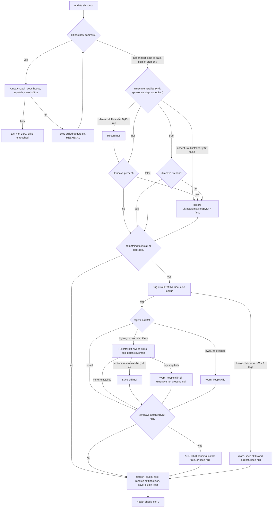
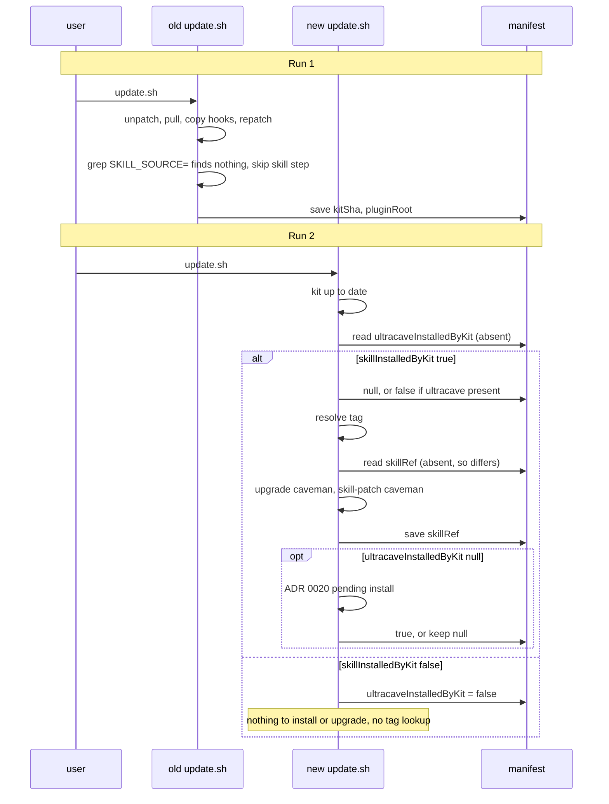

# ADR 0021: Install the latest upstream release, not a pinned tag

**Status:** Accepted. Amends ADR 0001 (pinned install), ADR 0003 (manifest fields) and ADR 0007 (skill upgrade when the pin changed).

**Context:**

`install.sh` hardcodes `SKILL_SOURCE="JuliusBrussee/caveman@v4.0.1"`, and `update.sh` greps that line out of `install.sh`. A skill upgrade therefore needs a kit commit that edits the pin. The last two pin bumps (`a8eec6c`, `f14f5f7`) were commits titled "Update install.sh" with no ADR. The v3.0.0 to v3.2.0 bump crossed upstream's v3.1.0 format split and broke `ultra` silently (ADR 0020). So the pin gave neither freshness nor safety.

`update.sh` also exits early with "already up to date" when the kit has no new commits. A new upstream release would not be noticed by that path.

`update.sh` runs from the kit checkout and pulls it mid-run. The script that runs is the one from before the pull. So any change to `update.sh` takes effect one run late.

**Decision:**

1. **"Latest" is the newest release tag.** `install.sh` and `update.sh` resolve it with `git ls-remote --tags --refs https://github.com/JuliusBrussee/caveman`, keep tags matching `vMAJOR.MINOR.PATCH` (no prerelease suffix), and pick the highest by version order. Upstream `main` is not used: it can carry unreleased format changes (it is 124 commits ahead of `v4.0.1`).
2. **One shared resolver.** The lookup lives in one helper sourced by both scripts. `update.sh` no longer parses `install.sh`. `install.sh` keeps no line matching `SKILL_SOURCE=`. The repository constant is renamed to `SKILL_REPO`. This rename protects the first legacy run. Verified in the pre-change `update.sh`: line 164 sets `SKILL_SOURCE` from `grep 'SKILL_SOURCE=' "$KIT_DIR/install.sh" | head -1 | cut -d= -f2`, and line 165 runs the `npx skills add` call only under `[ -n "$SKILL_SOURCE" ]`. With no match the result is empty, so the old script skips the skill step and prints nothing for it. It then continues to `refresh_plugin_root`, the `settings.json` repatch and `save_plugin_root` (lines 177-191). It never installs an unpinned ref.
3. **Override, persisted.** `CAVEMAN_KIT_SKILL_REF=<tag>` skips the lookup and installs that tag.
   - The tag must match `vMAJOR.MINOR.PATCH` and be `v3.1.0` or later. Older tags predate the `ultracave` split (ADR 0020). Branch names and other refs are rejected. A rejected value takes the decision 7 failure path.
   - When set, the tag is saved in the manifest as `skillRefOverride`. Later runs without the variable use the saved tag and skip the lookup. This makes the override hold a known-good tag across plain `update.sh` runs.
   - `CAVEMAN_KIT_SKILL_REF=latest` clears `skillRefOverride` and returns to the lookup.
   - `update.sh` prints the held tag on every run, so a forgotten hold is visible.

   ```mermaid
   stateDiagram-v2
       [*] --> None
       None --> Held: CAVEMAN_KIT_SKILL_REF=vX.Y.Z, valid, at least v3.1.0
       Held --> Held: CAVEMAN_KIT_SKILL_REF=vX.Y.Z, valid, at least v3.1.0
       Held --> None: CAVEMAN_KIT_SKILL_REF=latest (cleared)
       None --> None: rejected value (invalid or below v3.1.0), error
       Held --> Held: rejected value (invalid or below v3.1.0), error
   ```

   `None` uses the lookup. `Held` uses `skillRefOverride`. A rejected value leaves the state unchanged.
4. **Manifest records the tag.** The manifest gains `skillRef`: the tag of the last fully successful skill install or upgrade (decision 6). It is `null` until the kit installs a skill. A tag upgrade (decision 6) and `install.sh` own it. The ADR 0020 pending step writes it only when it is `null`, recording the tag it installed. The lookup runs only when something must be installed or upgraded: a present kit-owned skill, or a pending `ultracave` that is missing. The presence-based transitions run before and without it (ADR 0020 decision 7): `null` with `ultracave` present, `true` with `ultracave` missing, and an absent field with `skillInstalledByKit: false` are each recorded as `false`. Any other run needs no network call.
5. **`update.sh` order: kit first, then skills, on every run.**
   - Kit step, only when the kit has new commits: unpatch, pull, copy hooks, repatch, save `kitSha`. Then `exec` the pulled `update.sh` with `CAVEMAN_KIT_UPDATE_REEXEC=1`. The re-executed script finds the kit up to date and goes on to the skill step. The variable stops a second re-exec.
   - The presence step, the skill upgrade check and the pending step run on every run. The "kit is up to date" message only skips the kit step. The script exits after the skill steps, not before them.
   - Presence step, with no network call: apply the presence-based transitions (decision 4). A legacy absent field with `skillInstalledByKit: true` becomes `null`. A kit-owned (`true`) `ultracave` that is missing is recorded `false` and not reinstalled by the upgrade (ADR 0020 decision 8).
   - Skill step, only when something must be installed or upgraded: resolve the tag (or the held override). When it is higher than `skillRef`, or a held override differs from it, upgrade the kit-owned skills (decision 6). When the resolved latest tag is lower than `skillRef` and no `skillRefOverride` is set, install nothing: warn and keep the skills. A downgrade happens only through an explicit override.
   - Pending step, after the upgrade check and independent of it: when `ultracaveInstalledByKit` is still `null`, run the `ultracave` pending install. It runs even when the tag equals `skillRef`. A `skillRef` that advanced while `ultracave` stayed `null` therefore never hides the retry. The pending step changes `skillRef` only when it is `null` (decision 4).
   - After these steps, `update.sh` runs `refresh_plugin_root`, repatches `settings.json` with the resolved `pluginRoot`, and runs `save_plugin_root`, as it does today (lines 177-191). This runs on every run, so a `caveman` reinstall that moves `pluginRoot` is repatched in the same run.
   - So skills never change under old hooks. If the kit step fails, `update.sh` exits non-zero before the skill step, and the skills stay as they were. If the skill step fails, new hooks run on the old skills. The ADR 0020 fallback covers a missing or empty `ultracave`.
6. **Upgrade is all-or-nothing for `skillRef`.** The upgrade reinstalls each kit-owned skill at the tag, then re-runs `lib/skill-patch.js` on `caveman` if the kit owns it (ADR 0002). `skillRef` advances only when at least one kit-owned skill was reinstalled at the tag and every reinstall plus the patch succeeded. Otherwise it is left unchanged, so the pending step's "write when `null`" rule (decision 4) can apply. On any failure:
   - It prints a warning naming the failed step, keeps the old `skillRef`, and finishes the update.
   - If a reinstall leaves `ultracave` not present, `ultracaveInstalledByKit` becomes `null`, and the pending step retries it (ADR 0020 decision 7).
   - The two skills may sit at different tags until the next run. `skillRef` still names the last tag at which all kit-owned skills were consistent.
   - If `skill-patch.js` failed, `caveman` lacks `disable-model-invocation` until the next run. The model can auto-invoke it in that window. The warning says so.
   - The next run sees the tag still differs from `skillRef` and retries all steps. Reinstall and patch are idempotent.

   Staging the reinstall and swapping at the end was considered. `npx skills add` writes into the skills directory itself, so the kit would need its own copy logic. Retry on next run is simpler and gives the same end state.
7. **Lookup failure.** An empty set of qualifying `vX.Y.Z` tags counts as a lookup failure. When `caveman` is missing, `install.sh` takes its existing skill-install failure path: abort with the manual `npx skills add` command (ADR 0001 decision 4). When `caveman` is present and only `ultracave` is missing, the failure is soft: warn, record `ultracaveInstalledByKit: null`, and finish (ADR 0020 decision 6). `update.sh` prints a warning, keeps the installed skills and `skillRef`, keeps a pending `ultracaveInstalledByKit: null`, and finishes the kit update. The presence step (decision 5) has already run, so its transitions never depend on the lookup. Neither falls back to `main` or to a built-in tag: that would hide the failure. The manual command is `npx skills add JuliusBrussee/caveman@<tag> --skill <skill> -a claude-code -g --copy`. It is pinned to the resolved (or held) tag, else to `skillRef`. When neither exists, the kit prints it with the literal placeholder `<tag>`, the URL https://github.com/JuliusBrussee/caveman/releases, and the words "use the newest vX.Y.Z release". The kit never prints an unpinned command. The release notes point at the same releases page (ADR 0020, Consequences).
8. **Only kit-owned skills are touched** (ADR 0001, ADR 0003). `skillInstalledByKit` governs `caveman` and `ultracaveInstalledByKit` governs `ultracave` (ADR 0020). If the kit owns only `ultracave`, only `ultracave` moves to the new tag and the user's `caveman` is left alone. `skillRef` records what the kit installed, not what the user has. The two skills may therefore be at different versions. A user-managed `caveman` at a different tag from a kit-owned `ultracave` can point at an `ultracave` of another version. This is accepted: the hook injects `ultracave` directly in `ultra` mode, and the slash-command alias only names the skill.



Legacy two-run migration (Consequences):



**Consequences:**

- Skills stay current without a kit commit. Installs pick up new releases on their next `update.sh` run, with no manual step.
- Legacy installs migrate in two runs. The first run executes the pre-change `update.sh`: it pulls, copies the new hooks, repatches, and skips its skill step (decision 2). The new hooks fall back to the caveman body for `ultra` (ADR 0020 decision 5). The second run executes the new script. A manifest without `skillRef` is treated as "differs", so that run moves kit-owned skills to the latest tag. The pending step then runs the `ultracave` migration (ADR 0020 decision 7). A legacy manifest with `skillInstalledByKit: false` records `ultracaveInstalledByKit: false` and installs nothing. The release notes tell users to run `update.sh` twice.
- The kit now accepts upstream format changes the moment a release is tagged. The v3.1.0 break is the example of what this can cause. Mitigations: the soft-fail hooks (ADR 0020 decision 5), a bats fixture in the current upstream shape, and the persisted `CAVEMAN_KIT_SKILL_REF` hold.
- A held tag stops all skill upgrades until the user clears it. The per-run notice is the only reminder.
- Installs are no longer reproducible by kit commit. Two runs of `install.sh` a week apart can install different skill text.
- `install.sh` and `update.sh` need network access and `git` at run time for the tag lookup, on top of `npx`. A failed lookup never blocks `update.sh`, and blocks `install.sh` only when `caveman` must be installed (decision 7).
- The manifest gains `skillRef` and `skillRefOverride`. Both live in `manifest.json`, which `uninstall.sh` already removes with `~/.caveman-kit`, so uninstall needs no new branch.
- ADR 0001 decision 1 and the `SKILL_SOURCE` constant are superseded for the version part. The repository part (`JuliusBrussee/caveman`) stays hardcoded.

**Rejected alternatives:**

- Keep the pin and bump it by an automated job. This keeps reproducibility but still needs a kit commit per release, and the last bumps show such commits get no review.
- Track upstream `main`. It carries unreleased format changes (decision 1).
- Require `CAVEMAN_KIT_SKILL_REF` on every run instead of persisting it. One plain run would silently move off the held tag, so the variable would not work as a hold.
