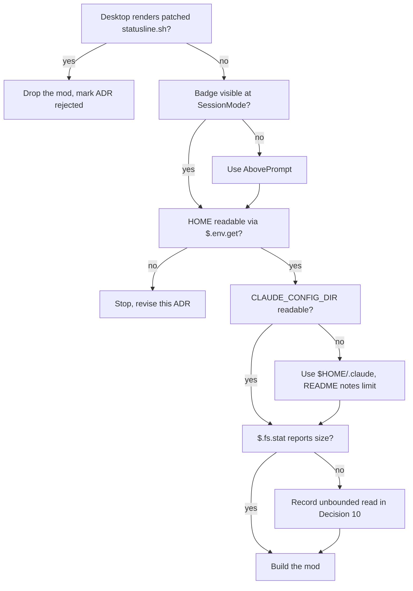
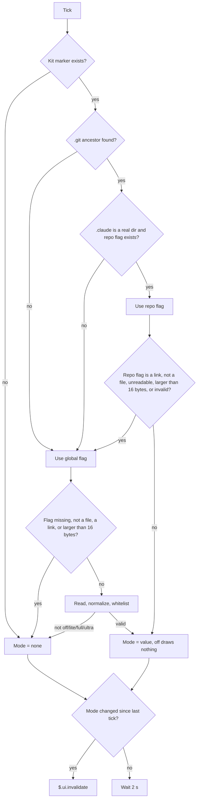
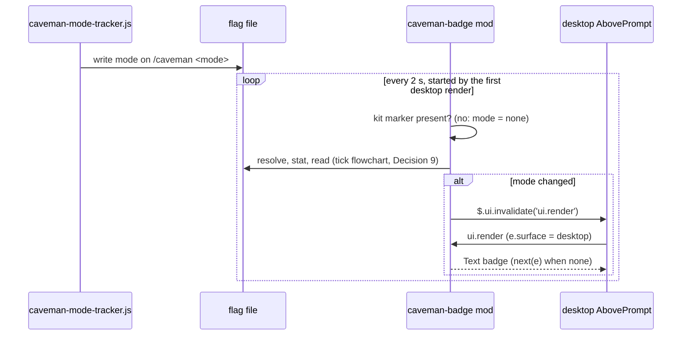

# ADR 0022: Show the mode badge in the desktop app with a separately installed mod

**Status:** Accepted (prototype gate passed 2026-10-29, see Prototype result). Adds a component beside ADR 0003 (no new manifest field) and ADR 0004 (a third copy of flag resolution). Decision 6 is superseded, and Decisions 7 and 12 are amended, by ADR 0023 (icon badge). Decision 10 reads "three fixed chips" instead of "three fixed strings".

**Context:**

The mode badge is a shell block that `lib/statusline-patch.js` inserts into the user's `statusline.sh`. The desktop app's Code tab may not render a custom `statusLine` script; no official page says either way (`docs/research/2026-10-29-claude-code-plugins-cli-vs-desktop.md`, section 3). This ADR assumes desktop users therefore see no mode indicator. The Decision 7 prototype verifies that assumption first.

A plugin cannot ship a `statusLine` setting. Its `settings.json` honors only `agent` and `subagentStatusLine`. A mod can draw in the desktop app. A mod is a plugin whose `hooks/hooks.json` lists a JavaScript module, and it can draw at documented render sites. `SessionMode` (the mode labels in the footer, below the prompt) and `AbovePrompt` (the band above the prompt) both render on the terminal and desktop. Mods need bundled Claude Code v2.1.286 or later on desktop. ([mods reference](https://code.claude.com/docs/en/plugins/mods/reference.md#render-sites); research note, section 5.)

A mod runs under constraints that shape this decision:

- **No Node built-ins.** A mod can import sibling files statically. It cannot `require` anything or use `fs` or timers. Files go through `$.fs` (`read`, `exists`, `stat`, `list`, `ancestors`), which has no `lstat`. So `hooks/caveman-config.js` cannot be reused.
- **No file watch.** A mod can redraw on a timer (`$.clock.every`) through `$.ui.invalidate('ui.render')`, throttled to 10 redraws a second. The flag file is written by the kit's command hooks. Their order relative to a mod's `classic.UserPromptSubmit` hook is not documented.

The kit's own deployment stays as it is: `install.sh` patches `settings.json` and `statusline.sh`, and nothing moves into a plugin.

**Prototype result (2026-10-29, Claude Code 2.1.309, desktop Code tab):**

- The desktop Code tab did not render the patched `statusline.sh` badge. The premise holds.
- A label appended to `SessionMode.props.modes` was not visible. A `Text` drawn at `AbovePrompt` was visible. The mod therefore draws at `AbovePrompt` (Decision 7 fallback).
- `$.env.get('HOME')` returned the home directory. `$.env.get('CLAUDE_CONFIG_DIR')` returned `undefined` (unset in that session, so readable-but-unset and unreadable are indistinguishable). The `$HOME/.claude` fallback applies.
- `$.fs.stat` returns `{ kind, size, isLink }` for the path itself, and `kind` is what a link leads to. The 16-byte cap and the link rejection therefore work without the deviations Decision 10 allowed for. `$.fs.ancestors` reads only named `.md` files, so it cannot find `.git`: the mod walks up with `$.fs.stat` on `<dir>/.git` instead.

**Decision:**

1. **Badge only, read-only.** The mod shows the current mode and never writes a flag file. The command hooks stay the only writers.
2. **Desktop only.** The `ui.render` hook draws only when `e.surface === 'desktop'`. On any other surface it returns `next(e)` unchanged. The terminal keeps the patched `statusline.sh` badge, so it never shows two badges. VS Code renders neither `SessionMode` nor `AbovePrompt`, so it gets no badge. Retiring the shell badge in favor of the mod is out of scope and would need its own ADR.
3. **Lives in this repo, installs on its own.** The mod is a plugin named `caveman-badge` at `plugins/caveman-badge/`. A marketplace manifest at the repo root points to it by relative path. Users install it with `/plugin marketplace add nj4x/caveman-kit`, then `/plugin install caveman-badge@caveman-kit`. Marketplace plugins are copied to a cache, so every file the mod imports must sit inside `plugins/caveman-badge/`.
4. **The install scripts leave it alone.** `install.sh`, `update.sh` and `uninstall.sh` neither install nor remove the mod. No manifest field records it. The ADR 0003 symmetry rule does not apply, because the kit makes no install-time change for the mod. The README documents how to install it and the minimum version. The one mod-related line in the scripts is a printed reminder: at the end of a run, `uninstall.sh` prints one line, on both successful endings (the best-effort one included), telling the user to run `/plugin uninstall caveman-badge@caveman-kit` if they installed the badge mod. It prints this unconditionally. It does not try to detect whether the mod is installed, because that would mean reading Claude Code's plugin state, which the kit does not own. The reminder changes no file and reads no state, so the scripts still neither install nor remove the mod, and the manifest still gains no field.
5. **No fallback below the minimum version.** On desktop older than v2.1.286 the mod does not load and no badge appears. There is no warning.
6. **Same strings as the shell badge.** (Superseded by ADR 0023: the desktop badge is a chip of bones.) The badge is `[CAVEMAN]` for `full`, `[CAVEMAN:LITE]` for `lite` and `[CAVEMAN:ULTRA]` for `ultra`, as plain `Text`. For `off`, a missing flag, an unreadable flag or an invalid flag the mod draws nothing extra.
7. **Draw at `AbovePrompt` (was: `SessionMode`).** (Amended by ADR 0023: the element is a `Box` holding an `Svg`, not one `Text` row.) The prototype showed `SessionMode` labels are not drawn on desktop, so the hook draws one `Text` row at `AbovePrompt` and returns `next(e)` when there is no badge. The text below keeps the original `SessionMode` reasoning for the record. The original plan: the hook returns a `Box` that holds `next(e)` followed by the badge `Text`, so the native mode labels stay. `PromptHint` was rejected: its content changes while the user types (`isDraft`) and while Claude works (`isWorking`), so the badge would flicker. The docs do not say where desktop draws `SessionMode`, and the shape of its `modes` prop is undocumented. So the first implementation step is a throwaway prototype, loaded with `claude --plugin-dir`, that confirms three things, in the order shown in the gate flowchart below. First, the desktop Code tab does not already render the patched `statusline.sh`. If it does, desktop already has a badge, the premise in Context fails, and the mod is dropped: this ADR is then marked rejected and nothing is built. Second, the badge is visible in the desktop Code tab. Third, `$.env.get('HOME')` and `$.env.get('CLAUDE_CONFIG_DIR')` are readable from the mod runtime on desktop, because Decision 9 needs `CLAUDE_CONFIG_DIR` and `HOME` to locate the global flag and Decision 11 needs `HOME` to locate the kit marker. If `HOME` is not readable, the design does not hold as written and this ADR must be revised before implementation continues. If `CLAUDE_CONFIG_DIR` is not readable, the mod falls back to `$HOME/.claude`, which matches the default case. Users who relocate their config with `CLAUDE_CONFIG_DIR` would then see a badge built from the wrong global flag, and the README documents that limitation. If the badge is not visible, the mod draws at `AbovePrompt` instead, as one `Text` row (it passes through `next(e)` when there is no badge, and while a survey holds the band). The prototype took this branch. The prototype also checks whether `$.fs.stat` reports a file size, which Decision 9 relies on.


8. **Poll the flag every 2 seconds.** The desktop `AbovePrompt` render hook starts `$.clock.every` at 2 seconds the first time it runs, so no other surface polls. Timers stop when the module reloads, and the next desktop render starts one again. (The original plan also started it on `session.start`. That was dropped in review: `session.start` cannot tell the surface, so the terminal would poll for nothing.) Each tick resolves and reads the flag. It calls `$.ui.invalidate('ui.render')` only when the mode differs from the last value it saw. Redrawing on `classic.UserPromptSubmit` was rejected: that hook may run before the kit's command hook writes the flag, so the badge could lag one turn.
9. **A third copy of the ADR 0004 resolution.** The mod follows the JS hooks (`hooks/caveman-config.js`), which are the reference implementation. One tick runs the steps in the flowchart below:
   - It checks the kit marker (Decision 11).
   - It walks up from `$.session.cwd()` with `$.fs.stat` on `<dir>/.git` to the first directory that has one (`$.fs.ancestors` cannot: it reads only named `.md` files).
   - It uses `<repo>/.claude/.caveman-mode` only when `.claude` is a real directory, not a link, and that file exists. A symlinked `.claude/` falls back to the global flag, as `resolveFlagPath` does.
   - Otherwise it uses `${CLAUDE_CONFIG_DIR:-$HOME/.claude}/.caveman-active`, with both values read through `$.env.get`.
   - It rejects a flag file when it is a link, not a regular file, unreadable, or `$.fs.stat` reports a size above 16 bytes. This matches `readFlag`, which returns null in both cases. A rejected repo flag (rejected as above, or not `off`/`lite`/`full`/`ultra`) falls back to the global flag, because the hooks do the same (`readFlag(flagPath)` null, then `readFlag(globalFlag)`), and the badge must show the mode the hooks apply. A valid `off` does not fall back. (Amended in review. The first draft said a rejected repo flag does not fall back, which contradicted the hooks.)
   - It reads the file, lowercases the text, strips everything outside `a-z0-9-`, and accepts only `off`, `lite`, `full` or `ultra`. `off` draws no badge. The stripping follows the shell block. `readFlag` only trims, so a hand-edited `lite!` is accepted by the badge and rejected by the hooks. That drift is accepted.

   `$.fs.read` cannot read a byte range, so the 16-byte cap comes from the size check before the read, not from the read itself. The prototype confirmed `$.fs.stat` reports `size`, so the second deviation in Decision 10 does not apply.


10. **Best-effort symlink handling, as a deliberate deviation.** The kit's invariant is that `readFlag` rejects symlinked flag files and `resolveFlagPath` uses `lstat`. When this ADR was drafted, `$.fs` looked as if it had no `lstat`. The prototype showed `$.fs.stat` reports `isLink` for the path itself, so the mod rejects a linked `.claude` and a linked flag file exactly as `lstat` would, and the deviation below did not materialize. The text that follows is kept for the record. The plan was to check `isLink` from `$.fs.list`, and whether `$.fs.read` follows symlinks is not documented. The badge is read-only and its output is limited to three fixed strings, so a hostile symlinked flag can make it show a wrong mode but cannot leak file contents or write anything. That residual risk is accepted. If `$.fs.stat` turns out to report no size (Decision 7 gate), the 16-byte cap is lost as well. A hostile repo could then commit a flag file of up to 4 MiB, and the mod would read it every 2 seconds. That costs time but leaks nothing, because the result still reduces to one of three strings. This second deviation is accepted on the same grounds. The kit's direct reuse was also considered: running `hooks/caveman-config.js` through `$.process.run` would keep one copy and the real `lstat` check. It was rejected because it spawns a `node` process every 2 seconds, and the desktop app's environment does not guarantee `node` on `PATH`. Any future change that makes the mod write a flag must first restore the full invariant.
11. **No badge without the kit.** Before it resolves any flag, the mod checks that `$HOME/.caveman-kit/hooks/caveman-activate.js` exists. Both `uninstall.sh` paths remove `~/.caveman-kit` (`rm -rf "$KIT_HOME"`), the best-effort path included. If the file is missing, the mod draws nothing extra, exactly as for `off`. So the badge cannot claim a mode after `./uninstall.sh` has removed the hooks that inject the ruleset. Without this check, a user who ran `/caveman ultra` and then uninstalled the kit would keep seeing `[CAVEMAN:ULTRA]`, because the flag files survive uninstall. The check uses the file the SessionStart hook runs, not `manifest.json`, because the hook file is what makes caveman mode actually take effect. It reads only an existing file, so Decision 4 still holds: the install scripts gain no step and the manifest gains no field. The 2-second tick re-checks the marker, so the badge disappears within one tick of uninstall. Two weaker alternatives were rejected. Having `uninstall.sh` delete the flag files would add a mod-related mutation to the install scripts, which Decision 4 rules out. Accepting a stale badge and noting it in the README would leave the badge showing a mode that is not active. The printed uninstall reminder in Decision 4 complements this check rather than replacing it: the check keeps the badge blank whether or not the user follows the reminder. The hand-edited `settings.json` gap is recorded under Consequences.
12. **A pure helper and one shared test table.** (Amended by ADR 0023: formatting moved to `chip.mjs`, and the table compares modes, not strings.) The resolve, parse and format logic lives in a helper module that `$` never reaches. `resolveMode({ home, configDir, cwd, fs })` takes an injected `fs` with `stat` (returning `{ kind, size, isLink }`, or null when missing) and `read`, and it also performs the kit-marker check from Decision 11. The entry module holds only the `$` wiring (render hook, timer, invalidate). The repo's existing test tooling runs the helper without the mods runtime. One table of cases runs against both the shell badge block and the helper, so the two copies cannot drift: repo flag present, repo `.claude/` without a flag, global flag only, no flag, an invalid flag, `off`, a symlinked flag, a symlinked `.claude/`, and a flag file larger than 16 bytes. Each row states the expected result. The mod helper must match the JS hooks on every row. Review added rows for a symlinked repo flag, an invalid repo flag (both fall back to global in the mod, nothing in the shell block), a repo `off` over a global mode, a subdirectory cwd, `CLAUDE_CONFIG_DIR`, and case normalization. The shell block today differs on the symlinked-`.claude/`, oversized and rejected-repo-flag rows. It follows a symlinked `.claude/`, because `[ -f ]` follows links. And it reads the first 16 bytes of an oversized file with `head -c 16` instead of rejecting it. The table marks those rows as known shell divergences, and fixing the shell block is a separate change. One extra case runs only against the helper: a valid flag with the kit marker missing must produce no badge. The shell badge does not need this case, because `uninstall.sh` removes the shell block along with the kit. The JS hooks already have their own tests.

```text
.claude-plugin/
  marketplace.json          # name caveman-kit; plugins[0].source "./plugins/caveman-badge"
plugins/caveman-badge/
  .claude-plugin/plugin.json
  hooks/hooks.json          # "modules": ["./register.tsx"]
  hooks/register.tsx        # $ wiring: ui.render on AbovePrompt (desktop only); first desktop render starts the poll
  hooks/badge.mjs           # pure: resolveMode (kit marker, flag resolution), parseMode (injected fs); formatBadge moved to chip.mjs by ADR 0023
tests/
  badge-parity.bats         # one case table, run against statusline block and badge.mjs
  helpers/badge-run.mjs     # runs badge.mjs on the real file system for the table
```



**Consequences:**

- **Three copies of flag resolution.** The rule now lives in `hooks/caveman-config.js`, the shell block in `lib/statusline-patch.js` and `plugins/caveman-badge/hooks/badge.mjs`. Any change to ADR 0004 resolution must update all three. The shared parity table catches drift between the two badge copies. It does not cover `caveman-config.js`.
- **No uninstall path, but no stale badge.** `uninstall.sh` leaves the mod installed. It prints a reminder to run `/plugin uninstall caveman-badge@caveman-kit`, and the README says the same. Users who never installed the mod see the reminder too, because it is unconditional. Until they remove the mod, it stays loaded but draws nothing, because Decision 11's marker is gone. The leftover flag files do not affect it.
- **Hand-edited `settings.json` is unsupported.** If the user removes the kit's hook entries from `settings.json` by hand and leaves `~/.caveman-kit` in place, the marker still exists, so the badge keeps showing the persisted mode although no hook injects the ruleset. This state is outside the kit's supported paths and is accepted. The supported way to disable the kit is `./uninstall.sh`, or `/caveman off`.
- **The mod depends on the kit's install path.** The marker path `$HOME/.caveman-kit/hooks/caveman-activate.js` is hard-coded in the mod. If the kit ever moves `KIT_HOME` or renames that hook, the badge goes blank until the user updates the plugin, because the kit and the plugin update independently (Decision 3). Such a change should keep the old marker path working for one release, or the README should tell users to update both.
- **Up to 2 seconds of lag.** The badge can show the old mode for up to 2 seconds after a switch. Each tick costs a few `$.fs` calls, which is negligible.
- **Not visible everywhere.** WSL sessions, cloud sessions, claude.ai/code and VS Code show no badge. Sessions with `disableAllHooks`, managed mods policy or an untrusted folder show no badge either.
- **Prototype gate passed.** Decision 7's site moved to `AbovePrompt` after the desktop prototype (see Prototype result). The `SessionMode` text in Decision 7 is kept for the record.
