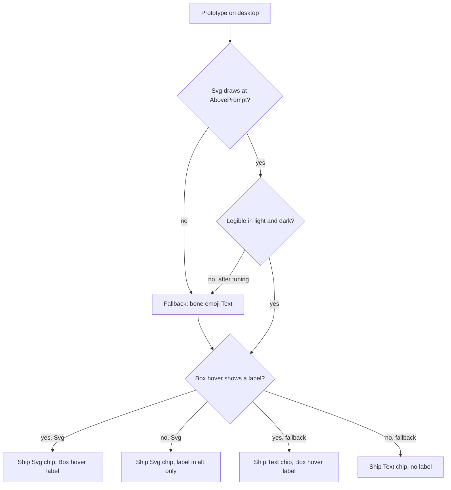

# ADR 0023: Draw the desktop badge as three bones

**Status:** Accepted (critic-approved 2026-10-30; prototype gate passed 2026-10-30, see Prototype result). The `Svg` chip ships, not the fallback. Amends ADR 0022 in three places. Decision 6 is superseded: the desktop badge is an icon chip, not text. Decision 7 is amended: the site stays `AbovePrompt`, but its "one `Text` row" becomes a `Box` holding an `Svg` (or, on the fallback path, a `Text`). Decision 12 is amended: (a) the "same strings" parity wording is dropped, so the parity table compares resolved modes (Decision 8 here); (b) the helper is split, with `formatBadge` removed from `badge.mjs` and display moved to a new `chip.mjs` (Decision 6 here); (c) the file tree changes to match. Every other decision in ADR 0022 stands: read-only, desktop only, the `AbovePrompt` site, 2-second poll, flag resolution, kit marker, and the pure `resolveMode` and `parseMode` helpers.

**Prototype result (2026-10-30, Claude Code desktop Code tab, light and dark themes):**

- (a) An `Svg` draws inside `AbovePrompt`. The bone and the three dots align and render crisply. (The prototype drew one bone plus three dots. Decision 1 later replaced the dots with bones, using the same fill-versus-35% technique.)
- (b) A hidden `Box` revealed by `hover` works for both the `Svg` and the `Text` variants. The label appeared to the right of the chip. The `Svg` `isInteractive` option also works: the `<title>` shows as a native tooltip, but it draws over the chip itself, and `Svg` in that mode ignores the width and height set inside the markup and draws at the slot size. The chip therefore uses the `Box` reveal, and passes explicit `width` and `height` as `Svg` props regardless.
- (c) The fixed `#B07A4B` fill is legible on the light and the dark band. The 35%-opacity faded elements are faint but readable in both. No tuning needed.
- (d) The prototype chip (one row of bone and dots) was about 12 px tall; the shipped column of three bones is 14 by 28 px. The band stays a full-width gray row and cannot shrink below one row.
- The gray rounded card behind the band is drawn by the desktop app, and a mod cannot remove it. A second prototype (2026-10-30) tried a transparent `Box`, a white `Box` and negative margins: the card stayed in all three (white only painted a white patch inside it, and negative margins only moved the content). An inline `Pane` instead of `AbovePrompt` did not show. The chip therefore sits on the gray card, and the card is accepted.
- The `Text` fallback also draws and follows the theme. It is not shipped.
- `hover` cannot swap text. It can only turn a hidden `Box` from `display: "none"` to `"flex"`, so the hover label is a hidden sibling next to the chip, inside the keyed `Box`.

**Context:**

ADR 0022 Decision 6 gives the desktop badge the same strings as the shell badge: `[CAVEMAN]`, `[CAVEMAN:LITE]`, `[CAVEMAN:ULTRA]`, as plain `Text`. In the desktop Code tab that renders as a full-width gray row holding bracketed capitals above the prompt. It works, but it is wide, loud and reads as a debug label. The desktop app can draw more than the terminal can. Per the mods reference (v2.1.290), `Svg` is drawn on desktop and VS Code but not in the terminal, and `Text` takes `size` and `weight`, and `Box` takes `padding`, `borderStyle`, `backgroundColor` and `hover`.

The site does not change. `SessionMode` is not drawn on desktop (ADR 0022 prototype result), so the badge stays one row at `AbovePrompt`. It cannot move into the footer beside the model and effort labels. "More compact" therefore means a small chip inside that row, not a smaller site.

**Decision:**

1. **Replace the text with an icon chip.** On desktop the badge is a column of three bones. The level is the number of solid bones, counted from the bottom up like a level meter: the bottom bone only for `lite`, the bottom two for `full`, all three for `ultra`. The unused bones stay in place, faded. The chip therefore has a fixed size and shows the scale. No `CAVEMAN` text is drawn. The level is carried by the bone count alone, not by color (color-only is unreadable for color-blind users) and not by a letter suffix (that brings text back). The chip is an `Svg` rather than the emoji `Text` variant for two reasons. An emoji is drawn by the operating system's emoji font, so its look varies by platform and cannot be matched to the faded bones. And `Svg` takes an `alt`, which gives a screen reader a clean mode name (Decision 4), while a `Text` of glyphs does not. The `Text` variant stays as the fallback in Decision 7.
2. **One `Svg`, fixed color.** The three bones are one `Svg` element, so they align exactly. The size is 14 px wide and 28 px high, set as `Svg` props (exported as `CHIP_WIDTH` and `CHIP_HEIGHT` from `chip.mjs`, with the markup's `viewBox="0 0 14 28"`). Fill is a fixed mid-tone (`#B07A4B`). Solid bones are drawn at full opacity. Unused bones are the same shape at 35% opacity. The docs do not say whether an `Svg` can follow the desktop theme, so a fixed mid-tone is chosen to be readable on both the light and the dark band. The prototype checks both themes (Decision 7, check c).
3. **Left-aligned chip, hover label.** The `Svg` sits in a `Box` at the left of the row, inside the band's own padding (the mod adds none). The chip `Box` is a row aligned to the center, and the `Svg` is wrapped in a `Box` with `flexShrink={0}` so the label cannot shrink it. The rest of the row stays empty. The chip `Box` has a `key`. A sibling `Box` drawn `display: "none"` with `hover: { display: "flex" }` holds the full label (`CAVEMAN · ULTRA`) for pointer users. If the prototype shows `hover` cannot reveal a label (Decision 7, check b), the chip ships without a hover label and the mode name lives in the `alt` only. If the row height cannot shrink below one text row (check d), the chip ships anyway at that height.
4. **Accessible name.** The `Svg` `alt` is `Caveman mode: lite`, `Caveman mode: full` or `Caveman mode: ultra`, so a screen reader announces the mode. The hover label alone would serve only pointer users.
5. **Unchanged when there is no badge.** For `off`, a missing, unreadable or invalid flag, or a missing kit marker, the hook still returns `next(e)` and draws nothing extra (ADR 0022 Decisions 6 and 11). `off` gets no dim icon.
6. **Split the helper: mode in, drawing out.** `badge.mjs` keeps `parseMode` and `resolveMode` and drops `formatBadge`. A new `plugins/caveman-badge/hooks/chip.mjs` exports `chipSvg(mode)`, which returns the SVG markup string for `lite`, `full` or `ultra` and `null` otherwise, and `chipLabel(mode)`, which returns `{ alt, hover }`: `alt` is `Caveman mode: <mode>` and `hover` is `CAVEMAN · <MODE>` (for example `{ alt: 'Caveman mode: ultra', hover: 'CAVEMAN · ULTRA' }`), or `null` for anything other than `lite`, `full` or `ultra`. If prototype check (b) fails, the build still returns `hover` from `chipLabel` but `register.tsx` does not wire it, so the helper's shape and tests do not change between variants. A third export, `chipText(mode)`, returns the fallback glyph string, one to three `🦴` emoji (`🦴`, `🦴🦴`, `🦴🦴🦴`), or `null`. The fallback has no faded state, so it shows only the solid bones, so the fallback has a producer and a test even if it never ships. Mode vocabulary: `off`, a missing, unreadable or invalid flag, and a missing kit marker all resolve to `none` inside `resolveMode`, which returns `null`. So `chip.mjs` only ever receives `lite`, `full`, `ultra` or `null`, and its `null` result for `off` or unknown input is defensive. `register.tsx` is the only place that wraps them in `Svg` and `Box`. The shell block in `lib/statusline-patch.js` is untouched: the terminal keeps the text badge, so the two copies no longer share display strings. One render of the hook runs as follows:

   ```text
   ui.render (AbovePrompt)                     register.tsx
   ├─ surface != desktop or hasSurvey ─> return next(e)
   ├─ startPolling($)                       2 s tick: resolveMode, invalidate on change
   ├─ mode == undefined ─> refresh($)       resolveMode (badge.mjs)
   ├─ svg = chipSvg(mode)                   chip.mjs
   ├─ mode == null (none) ─> return next(e)
   ├─ label = chipLabel(mode)               chip.mjs
   └─ return Box key="caveman-chip" { Box flexShrink=0 { Svg width=14 height=28 (one column of three bones, filled from the bottom up; the wrapper Box keeps the size when the hover label shows) }, Box display=none hover=flex marginLeft=1 { Text label.hover } }
   Variants: on the fallback path the Svg leaf is Text { chipText(mode) }; if check (b) failed, the Box has no hover.
   ```
7. **Prototype gate, fallback fixed at build time.** Before the real build, a throwaway loaded with `claude --plugin-dir` confirms on desktop: (a) an `Svg` draws inside `AbovePrompt`, (b) `hover` works on the chip, (c) the chip is legible in light and dark themes, (d) the row height with a small chip. Outcomes: if (a) fails, the build ships the fallback below. If (b) fails, the hover label is dropped (Decision 3). If (c) fails, the fill and the faded-bone opacity are adjusted and re-checked; if no single fixed tone is legible in both themes, the build ships the fallback, whose `Text` follows the theme. Check (d) is informational: the chip ships at whatever height the row has. The fallback is `Text` with the 🦴 emoji repeated once per level (one to three, no faded state), inside the same `Box`, whose `hover` shows the same label if (b) passed. `Text` has no `alt`, so on the fallback path a screen reader reads the glyphs, not `Caveman mode: <mode>`; that gap is recorded under Consequences. The mod cannot detect at runtime that an `Svg` failed to draw, so the choice is made once, at build time, from the prototype result. It is not a runtime switch.
8. **Parity table compares modes, not strings.** `tests/badge-parity.bats` runs one case table against the shell block and `resolveMode`. Its expected column becomes the resolved mode (`none`, `lite`, `full`, `ultra`), which the shell side derives from its printed `[CAVEMAN...]` string. The known shell divergences from ADR 0022 Decision 12 stay marked. A separate test checks `chipSvg` and `chipLabel`: one distinct SVG per mode, the right number of solid bones (1, 2, 3) and three bones in all, the `alt` and `hover` text, the `chipText` emoji count per mode, and `null` for `off` and unknown input.
9. **Version.** `plugins/caveman-badge/.claude-plugin/plugin.json` goes from `0.1.0` to `0.2.0`. The README "Desktop badge" section describes the bones, the level they show and the hover label. A user on `0.1.0` keeps the text badge until they update the plugin, because the plugin and the kit update independently (ADR 0022 Decision 3).

```text
plugins/caveman-badge/hooks/
  badge.mjs        # parseMode, resolveMode (formatBadge removed)
  chip.mjs         # new: chipSvg, chipLabel, chipText (all pure)
  register.tsx     # wraps chip output in Svg + Box on desktop
tests/
  badge-parity.bats      # expected column = resolved mode
  badge-chip.bats        # new: chip output per mode
```



**Consequences:**

- **Desktop and terminal look different.** Desktop shows an icon chip, the terminal shows `[CAVEMAN:ULTRA]`. Anyone comparing the two must know one, two and three solid bones map to lite, full and ultra. The README states it.
- **The icon has no word in it.** A new user may not know what the bone means until they hover. This is accepted for compactness. The hover label and `alt` cover it.
- **The gray card stays.** The desktop app draws a gray rounded card around the band, and no tested mod prop removes it. The chip is small, but it always sits on that card, one row tall at least.
- **Fixed color ignores the theme.** If the desktop theme later offers a way for an `Svg` to follow the text color, switching to it is a small change confined to `chip.mjs`.
- **The mod no longer shows the mode as text anywhere on desktop** except in the hover label. A screenshot of the chip alone does not say which mode it is without counting the solid bones.
- **The fallback has no clean screen-reader name.** On the `Text` path a screen reader reads the emoji, not `Caveman mode: <mode>`. This is accepted because the fallback ships only if `Svg` fails the prototype.
- **The fallback is a build-time decision.** If a later Claude Code release stops drawing `Svg` at `AbovePrompt`, the chip disappears and the badge is blank until the mod is updated. There is no runtime detection.
- **ADR 0022 Decision 10 still holds.** Its "three fixed strings" premise now reads "three fixed chips" (an SVG plus its `alt` and hover text). A hostile flag file can still only select one of them.
- **ADR 0022 Decision 6 is superseded and Decisions 7 and 12 are amended** (the drawn element, same-strings parity wording, `formatBadge` placement, file tree) for the desktop mod, as listed in Status. The parity table still guards the part that matters, which mode each copy resolves.
