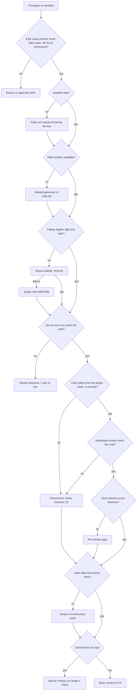

# ADR 0024: Animate the desktop badge bones

**Status:** Proposed (grilling session 2026-10-31, critic-approved 2026-10-31; prototype gate run 2026-10-31, see Prototype result; revised 2026-10-31 after the 2.1.309 types showed an audio API, stoppable timers and a `Client` module, which the first grilling pass had missed). Amends three earlier decisions. ADR 0023 Decision 2 (fixed color): solid bones now take a color from a palette. ADR 0022 Decision 8 (2-second poll): the poll keeps its interval and its flag work, and gains one duty: on a mode change it also resets the animation (Decision 6 here). ADR 0022 Decision 12 (the entry module holds only the `$` wiring): `register.tsx` now also holds one animation state object, but every transition on it is a pure function in `chip.mjs` (`stepAnimation`, Decision 10), so `register.tsx` still only wires `$` to it. When this ADR is accepted, the status lines of ADR 0022 and ADR 0023 get an "amended by ADR 0024" note pointing here. OS reduced-motion preferences are out of scope (Decision 7). ADR 0023 Decision 1 stands: the level is the count of solid bones, and color carries no meaning. Every other decision in ADR 0022 and ADR 0023 stands: read-only, desktop only, the `AbovePrompt` site, flag resolution, the kit marker, the hover label, the `alt`. The terminal badge in `lib/statusline-patch.js` is untouched.

**Prototype result (2026-10-31, Claude Code 2.1.309, desktop Code tab, two throwaway mods loaded by hot reload):**

- (a), (b), (d): the user reported the fall smooth, clipped at the chip edges and legible, with landed colors kept (for example `#C79A2E #C79A2E #B07A4B`, then `#B07A4B #B07A4B #BF6F86`).
- (c): `typeof Math.random` is `function`.
- (h): `$.clock.after(300)` fired at 301 to 307 ms, and a cancelled `after` never fired.
- (e) failed: `$.env.get('CAVEMAN_BADGE_ANIMATION')` and `$.env.get('CAVEMAN_BADGE_SOUND')` read `undefined`, including after `open -n -a Claude --env …`. The opt-outs therefore move to a slash command (Decision 7).
- (k) partly: `$.store.set` works from the mod. Whether another open session reads the value at once is not yet seen.
- `turn.complete` reached the mod. (j) is open: no `classic.Notification` has been seen yet, so the sound (Decision 13) is not built until it is.
- (f) is inconclusive: the `Client` probe line did not appear, so the `Svg` string swap from the hooks module ships, as Decision 8 provides. (i) was not observed.

**Context:**

The desktop badge (ADR 0023) is a static chip: one `Svg`, 14 by 28 px, three bone slots, solid count = level, all bones in `#B07A4B`. The chip never changes unless the mode does. The user wants it to feel alive: the stack of bones falls apart at random moments and collects into a stack again, and the bone color changes from time to time.

What a mod can and cannot do shapes the design:

- **Redraw only.** A mod has no CSS animation. It redraws through `$.clock.every(ms, fn)` plus `$.ui.invalidate('ui.render')`, throttled to 10 redraws a second (research note `docs/research/2026-10-29-claude-code-plugins-cli-vs-desktop.md`, section 5). Whether the desktop `Svg` supports in-markup animation (`<animate>`) is undocumented.
- **Audio exists.** The 2.1.309 mod API has `$.audio.play({ asset }, { gain })`, which plays a sound file shipped in the plugin. The engine uses `afplay` on macOS and plays nothing where it has no player (the types do not say whether desktop on Windows plays). The research note predates this (it listed no audio route), and the first grilling pass wrongly rejected sound on that ground. The user chose sound on by default after the API was found.
- **Timers can stop.** `$.clock.every(ms, fn)` returns `cancel()`, and `$.clock.after(ms, fn)` runs once and can be cancelled. `$.clock.now()` gives the time.
- **A `Client` surface module exists.** A `Client` is a module the desktop runs itself, with local state (`setState`) and its own frame clock (`every`), redrawing only its region. Its typed element table is the terminal's without `Client`, `Raster` and `Image`, and has no `Svg`, so it may not be able to draw the chip. Decision 8(f) tests this.
- **No window focus.** A mod cannot tell whether the window is in the background, so anything periodic runs in every open desktop session.
- **A full chip.** The 14 by 28 px column is full when the mode is `ultra`, and the band cannot shrink below one text row (ADR 0023 prototype result d).

**Decision:**

1. **Frame-driven redraw.** The mod animates by replacing the `Svg` source string on each frame, at 8 frames a second (a 125 ms tick, under the 10-a-second throttle). A fall lasts about 2 seconds. Sixteen frames is a hard cap: the Decision 3 timings are tuned to fit inside it, and a test enforces it. The in-markup `<animate>` route is not used: it would be smoother, but nothing documents that the desktop `Svg` honors it. If the Decision 8 prototype shows frame redraws flicker in the band, this ADR is revised before anything is built.
2. **Only solid bones move.** The faded slots are the level meter (ADR 0023 Decision 1) and stay where they are, at 35% opacity, in `#B07A4B`. The solid bones fall and re-stack. A `lite` chip animates one bone, `full` two, `ultra` three. Moving bones are drawn on top of the faded slots, so a bone passes in front of a faded slot while it falls or rains in. A solid slot whose bone is away draws nothing, not a faded ghost: the level reading is suspended for the 2 seconds. Prototype check (d) confirms the gap reads as motion and not as a glitch.
3. **Geometry stays 14 by 28.** The chip does not grow. Bones fall out through the bottom edge of the `viewBox` and are clipped there. After a short beat they re-enter through the top edge and fall into their own slots, one after another, bottom slot first. Each falling bone gets a random horizontal offset (a few px) and a random rotation (up to about 40 degrees), so the stack scatters rather than dropping straight. Gravity is constant acceleration, with no bounce. All numbers are tuned in the prototype. A taller canvas (for example 14 by 40) was rejected: it makes the band taller for all users, all the time, to serve a 2-second effect.
4. **Palette color per landing.** The starting palette is `#B07A4B` (bone), `#C79A2E` (amber), `#6F9A6B` (sage), `#5F86B0` (slate blue) and `#BF6F86` (rose). The prototype checks every entry on the light and dark band (ADR 0023 check c) and the palette is retuned there. A bone keeps the color it last landed with while it falls out and while it rains back in. It takes its new random palette color on the frame it lands in its slot. The resting stack keeps those colors until the next fall, so a stack can be multicolored. Since the module loaded (Decision 9), until the first fall, and with the animation off, every solid bone is `#B07A4B`, exactly as in `0.2.0`. Color is decoration only: the level is still the solid count, never a color (ADR 0023 Decision 1). The faded slots never take a palette color.
5. **Mostly at rest.** The chip rests as a static stack. A fall starts at a random delay of 20 to 60 seconds. A delay is set whenever the chip becomes drawn with nothing scheduled: at the first desktop render after the module loaded, and at the first render after the band was hidden. Later delays count from the end of the previous fall, or from a mode change (Decision 6). A countdown therefore never runs while the band is hidden, so a fall cannot start the moment the band returns. The delay and every frame offset come from an injected random source, so tests are deterministic. A constant loop was rejected: it redraws the band 8 times a second for no reason, and a permanent motion next to the prompt is a distraction. On WCAG 2.2.2 (Pause, Stop, Hide): each fall lasts about 2 seconds, under the 5-second line, but the falls recur for the whole session. Whether recurring short bursts count as one motion longer than 5 seconds is not settled here. The kit treats the opt-out (Decision 7) as the stop mechanism, and that opt-out is a build gate (Decision 8e), not an afterthought.
6. **Mode change and hidden band cancel the fall.** The 2-second flag poll keeps its interval and its flag work (ADR 0022 Decision 8). When it sees a different mode, including `none`, it also resets the animation. It drops any plan in progress, clears the landed state (all solid bones back to `#B07A4B`), sets the next fall time to now plus a fresh random delay, and redraws at once. A mode change at rest reschedules the same way, so a fall never starts right after a switch. A fall never plays for `none` (`off`, a missing or invalid flag, a missing kit marker), because `chipSvg` returns `null` for it. The render hook records whether it drew the chip on its last call. While it did not (`hasSurvey`, a surface other than desktop, or mode `none`), no fall starts and nothing calls `invalidate`. A fall already in progress when the band goes hidden is cancelled: the plan is dropped, the landed state stays, and nothing is scheduled (Decision 5). When the band is drawn again, the chip shows the resting stack and a fresh delay starts.
7. **Opt-out by slash command.** Prototype check (e) showed that environment variables do not reach the mod on desktop, so the switches are a slash command the mod registers in `session.start` through `$.command.register`: `/caveman-badge animation off`, `/caveman-badge animation on`, and `/caveman-badge status`, which reports both switches. Sound gets `/caveman-badge sound off|on` when it is built (Decision 13). A `command.run` hook stores the switch in `$.store` (key `animation`, `false` when off), so it survives restarts and applies to every session. The 2-second poll re-reads it, so another open session follows within one poll, and the session that ran the command applies it at once, without a reload. Off means static, as in `0.2.0`: the plan is dropped, no timer is armed, and the chip redraws at rest with the landed colors cleared. Unset or `true` means on. An unreadable store counts as on. The README documents the command. The kit does not read an OS reduced-motion preference: no documented mod API exposes one, so it is out of scope for now and can be added when one appears. Environment variables (`CAVEMAN_BADGE_ANIMATION=0`) were the first plan and were dropped after check (e).
8. **Prototype gate before the build.** A throwaway loaded with `claude --plugin-dir` confirms on desktop:
   - (a) An 8 fps source swap in `AbovePrompt` is smooth and does not flicker, flash the band or shift the layout. A hover label that is open stays open across frame swaps. A screen reader does not re-announce the `alt` on every frame. Typing in the prompt during a fall keeps focus, the caret and IME composition intact.
   - (b) Content outside the `viewBox` is clipped, so a bone vanishes at the bottom and top edges.
   - (c) `Math.random` is available in the mod runtime.
   - (d) Every palette color is legible in the light and the dark theme, and the rotated bones render crisply.
   - (e) `$.env.get('CAVEMAN_BADGE_ANIMATION')` and `$.env.get('CAVEMAN_BADGE_SOUND')` reach a value the user exported.
   - (f) A `Client` on desktop draws an `Svg` despite its typed element table, and animates it at its own frame clock with `setState`.
   - (g) `$.audio.play({ asset: 'sounds/clack.wav' }, { gain: 0.5 })` plays the shipped file on desktop and resolves without a prompt or trust dialog. The clack and its gain are tuned by ear here.
   - (h) `$.clock.after` and `$.clock.every(125, …)` both fire on schedule, and `cancel()` stops them.
   - (i) A desktop session that is not the visible one (another tab or session in front, or the window minimized) does or does not still call the `AbovePrompt` render hook.
   - (j) Which `classic.Notification` events reach a mod on desktop, and with which `notification_type` values, for a permission prompt, an `AskUserQuestion` dialog and an idle wait. They must also fire in a session that is not the visible one.
   - (k) `$.store.set` and `$.store.get` work from the mod, and a value one session sets is read by another open session.

   Outcomes:
   - If (a) fails, this ADR is revised or rejected. That includes a hover label that closes, an `alt` re-announced per frame, or lost prompt focus, caret or IME composition.
   - If (b) fails, the fall is revised so bones do not leave the `viewBox`: they fade out through the `opacity` field every frame already carries (Decision 10).
   - If (c) fails, a small seeded generator ships in `chip.mjs`.
   - If (d) fails, the palette is retuned and re-checked. If no multi-color palette passes both themes, the motion ships with the single color `#B07A4B` (`PALETTE` has one entry), which ADR 0023 already checked.
   - If (e) fails, this ADR is revised first. The desktop app may not pass shell exports to mods: ADR 0022's prototype saw `CLAUDE_CONFIG_DIR` unset. Both opt-outs then move to a place the mod can read, for example a marker file beside the kit marker.
   - If (f) passes, this ADR is revised before the build so the frames run inside a `Client` (local state and frame clock, no whole-band redraw per frame), with `stepAnimation` imported by the surface module and landings posted to the hooks module for sound. If (f) fails, the design stands: swap the `Svg` string from the hooks module.
   - If (g) fails to play, or needs a prompt, sound is dropped and Decision 13 is revised. If the clack sounds bad, it is retuned in `tools/make-clack.mjs` and re-checked.
   - If (h) fails, the ticker falls back to one always-on `$.clock.every(125, …)`, as the first revision of this ADR had it.
   - (i) is informational for the falls only: a session that is not visible and still renders the band keeps animating unseen. It does not affect sound, which follows attention events, not the band (Decision 13).
   - If (j) shows no attention event reaches the mod on desktop, sound is dropped and Decision 13 is revised. If only some types arrive, the trigger list in Decision 13 shrinks to those.
   - If (k) fails (the store does not work, or another session does not see the value), the 5 to 10 minute gap is kept per session instead of across sessions, and the Consequences say so.
9. **A stoppable timer, armed on demand.** `stepAnimation` (Decision 10) returns `wakeInMs`: the time until its next tick is needed. It is 125 during a fall, the time left to `nextFallAt` at rest, and `null` when nothing is scheduled (band hidden, opt-out, `off`). After every step `register.tsx` cancels its one pending timer and, when `wakeInMs` is not `null`, arms `$.clock.after(wakeInMs, …)`, whose callback sends the next `tick`. At rest nothing runs between falls: no tick, no comparison. When the band is hidden, `wakeInMs` is `null`, so the timer is left unarmed. The render hook sends a `tick` on a render that draws the chip while nothing is armed, so the first desktop render and the first render after a hidden band start the countdown. No other surface arms a timer, because only the desktop render hook sends that tick. With the opt-out set, the render hook never sends it. Timers stop when the module reloads, and the next desktop render starts them again (ADR 0022 Decision 8). A reload resets all animation state: landed colors clear to `#B07A4B`, and the first delay counts again from that render. The always-on `$.clock.every(125, …)` ticker, which the first revision of this ADR used because stopping a timer was unproven, is the fallback if prototype check (h) fails.
10. **A pure step function, wired in `register.tsx`.** `chip.mjs` stays pure (no `$`, no Node built-ins, no timers). It gains:
    - `PALETTE`.
    - `planFall(mode, landed, rng)`, which returns an array of at most 16 frames. Each frame holds, for every solid slot, its `dx`, `dy`, `rotate`, `opacity` and `color`. `opacity` is 1 in the design as shipped; the Decision 8(b) fallback uses it to fade bones out instead of leaving the `viewBox`. `landed` is the resting frame from the previous fall, or `null` for all `#B07A4B`. A bone shows its `landed` color until its landing frame, and its new palette color from the landing frame on. A slot whose bone is away draws nothing.
    - `nextFallDelayMs(rng)`, which returns 20000 to 60000.
    - `stepAnimation(state, event, rng)`, which returns `{ state, redraw, wakeInMs }`. `state` is one object: `{ off, nextFallAt, plan, frame, landed }`, where `landed` is `null` or a resting frame (the last frame of the previous plan). `event` is one of `{ type: 'tick', now, mode, drawn }`, `{ type: 'modeChanged', now, mode, drawn }` or `{ type: 'error' }`. `wakeInMs` is described in Decision 9. All transitions below live in this function, so they run under bats with a seeded random source. The fall is silent (Decision 13).
    - `shouldRing({ now, lastRangAt, nextGapMs, mode, isMuted })`, which returns `true` when a sound may play now: `mode` is not `none`, the sound is not muted, and `now - lastRangAt >= nextGapMs`, or there is no `lastRangAt`. `nextRingGapMs(rng)` returns 300000 to 600000 (5 to 10 minutes).
    - An optional second argument to `chipSvg(mode, frame)` that draws the solid bones from a frame.

    `chipSvg(mode)`, `chipSvg(mode, null)` and `chipSvg(mode, undefined)` all return exactly what `0.2.0` returns. `chipLabel` and `chipText` are unchanged. `register.tsx` holds the state object, calls `stepAnimation` from the on-demand timer, the render hook and the 2-second poll, calls `$.ui.invalidate('ui.render')` when `redraw` is true, and passes `Math.random` and the current time from `$`. The render hook draws `chipSvg(mode, plan ? plan[frame] : landed)` and records whether it drew the chip (`drawn`).

    **Failure policy.** `register.tsx` wraps the timer callback and the frame draw in `try`/`catch`, as `refresh` already is. Any error sends the `error` event: the state becomes `off`, with the plan and `landed` dropped, and the render hook draws the static `chipSvg(mode)` until the module reloads. The 2-second mode poll keeps running untouched, so the badge stays correct.

    The transitions inside `stepAnimation`:

    ```text
    stepAnimation(state, event, rng)              chip.mjs
    ├─ state.off ─> no change, redraw false
    ├─ error ─> off = true; plan = null; landed = null; redraw true
    ├─ modeChanged
    │  ├─ plan = null; landed = null
    │  ├─ drawn ─> nextFallAt = now + nextFallDelayMs(rng)  else nextFallAt = null
    │  └─ redraw true
    └─ tick
       ├─ not drawn ─> plan = null; nextFallAt = null; redraw false   (landed stays)
       ├─ drawn, nextFallAt == null ─> nextFallAt = now + nextFallDelayMs(rng)   (first render, or band back)
       ├─ plan == null, now >= nextFallAt ─> plan = planFall(mode, landed, rng); frame = 0; redraw true
       ├─ plan != null
       │  ├─ frame++ ; redraw true
       │  └─ last frame done ─> landed = last frame; plan = null;
       │                        nextFallAt = now + nextFallDelayMs(rng)
       └─ otherwise ─> redraw false
    ```

    ```mermaid
    stateDiagram-v2
        [*] --> Unscheduled: module load
        Unscheduled --> Rest: chip drawn, delay set
        Rest --> Falling: random 20-60 s elapsed, chip drawn
        Falling --> Raining: bones out of the bottom edge
        Raining --> Rest: all solid bones landed, new colors kept, reschedule
        Rest --> Rest: mode changed (reset colors, reschedule, redraw)
        Falling --> Rest: mode changed (cancel, reset, reschedule)
        Raining --> Rest: mode changed (cancel, reset, reschedule)
        Rest --> Unscheduled: band hidden
        Falling --> Unscheduled: band hidden (cancel)
        Raining --> Unscheduled: band hidden (cancel)
        Rest --> Off: env opt-out or animation error
        Falling --> Off: animation error
        Raining --> Off: animation error
        Off --> [*]: module reload
    ```
11. **Tests.** `tests/badge-chip.bats` gains cases run through node with a seeded random source:
    - `chipSvg(mode)`, `chipSvg(mode, null)` and `chipSvg(mode, undefined)` all equal the `0.2.0` output.
    - A plan has at most 16 frames.
    - Every frame holds exactly as many entries as the level, in solid slots only.
    - Every color is in `PALETTE`, or equals the `landed` color of that slot.
    - Before a bone's landing frame its entry shows the `landed` color (`#B07A4B` when `landed` is `null`). From the landing frame on it shows a `PALETTE` color.
    - The last frame of a plan is the resting stack: `dx` 0, `dy` 0, `rotate` 0, `opacity` 1.
    - `nextFallDelayMs` stays in 20000 to 60000 over many draws.
    - The same seed gives the same plan.
    - `planFall` returns `null` for `off` and unknown input.
    - `sounds/clack.wav` exists, is a valid mono 16-bit WAV, lasts under 200 ms, and is under 32 KB. Running `tools/make-clack.mjs` into a temp file reproduces it byte for byte.
    - `shouldRing`: `false` for mode `none`, `false` when muted, `false` inside the gap, `true` at and after the gap, `true` with no `lastRangAt`. `nextRingGapMs` stays in 300000 to 600000 over many draws.
    - `stepAnimation`: `wakeInMs` is 125 during a plan, the time left to `nextFallAt` at rest, and `null` when nothing is scheduled; the first drawn tick sets `nextFallAt` and starts no fall; a tick before `nextFallAt` redraws nothing; a tick at `nextFallAt` starts a plan; a mode change clears `landed` and the plan and sets a fresh `nextFallAt`; a not-drawn tick cancels a plan, keeps `landed` and clears `nextFallAt`; the first drawn tick after that sets a fresh `nextFallAt` and starts no fall; an `error` event sets `off` and every later event changes nothing; the last frame sets `landed` and a fresh `nextFallAt`.

    The `$` wiring (timer start, env opt-out, `invalidate`, `try`/`catch`) is not unit tested, as before. The parity table is not affected, because it compares resolved modes.
12. **Version and docs.** `plugins/caveman-badge/.claude-plugin/plugin.json` goes from `0.2.0` to `0.3.0`. The README "Desktop badge" section describes the fall, the color change, that the terminal badge does not animate or sound, and the `/caveman-badge` command. A user on `0.2.0` keeps the static chip until they update the plugin (ADR 0022 Decision 3).
13. **Sound: a rare clack when the session needs the person, on by default.** The falls are silent. The mod plays one short wooden clack when a session needs the person: on a `classic.Notification` event, which the engine raises for a permission prompt, a question dialog and an idle wait for input. A finished turn (`turn.complete`) does not ring: in a busy session it ends every minute or so, and it does not mean the person is needed. Prototype check (j) confirms which `notification_type` values the desktop app sends. The list is narrowed to those that arrive, and to permission, question and idle among them.

    **Rate limit.** At most one clack per 5 to 10 minutes on the whole machine. After a clack, the mod draws a random gap of 5 to 10 minutes (`nextRingGapMs`) and stores `{ lastRangAt, nextGapMs }` in `$.store`, the plugin's JSON file shared by every session. On an attention event a session reads that value. It rings only when `shouldRing` says the gap has passed, and then writes a new value. An event inside the gap is silent and is not queued for later. Two sessions that read the store at the same moment may both ring: this race is rare and accepted, since it costs one extra clack. If prototype check (k) fails, the gap is kept per session.

    **Conditions.** No clack while the resolved mode is `none` (`off`, missing or invalid flag, missing kit marker), because the badge that owns the sound is not shown. The clack does play from a session that is not visible: that is the main case, the person being elsewhere. `/caveman-badge sound off` mutes it, stored in `$.store` like the animation switch (Decision 7). Sound and animation are independent: `/caveman-badge animation off` stops the falls and leaves the sound, and `/caveman-badge sound off` does the reverse. **Build status:** the sound is not built in `0.3.0`. It waits for prototype check (j) to show which `classic.Notification` events reach a mod on desktop.

    **Playback.** `register.tsx` hooks `classic.Notification` and returns `next(e)` unchanged, so other notification hooks and the engine's own notification still run. It calls `$.audio.play({ asset: 'sounds/clack.wav' }, { gain: 0.5 })` without awaiting it. A rejected play is caught and ignored, and it is not retried. The engine plays through `afplay` on macOS and nothing where it has no player, so non-macOS desktops stay silent without error. The clip is generated, not sourced: a committed script `plugins/caveman-badge/tools/make-clack.mjs` synthesizes a noise burst with a fast resonant decay into `plugins/caveman-badge/sounds/clack.wav` (mono, 16-bit, under 200 ms). That avoids a third-party license. The script is deterministic, and the committed `.wav` is its output. A CC0 sample was rejected: it sounds more natural, but needs license and attribution tracking.

    **Alternatives considered.** A clack on every bone landing (the first revision of this ADR) was rejected by the user after the prototype as too frequent: up to three clacks every 20 to 60 seconds. A clack on every finished turn was rejected for the same reason. Triggering a fall together with the attention clack was considered and dropped, so ambient motion and the audible nudge stay separate features.



```text
plugins/caveman-badge/
  .claude-plugin/plugin.json   # 0.2.0 -> 0.3.0
  hooks/chip.mjs               # + PALETTE, planFall, nextFallDelayMs, stepAnimation, chipSvg(mode, frame), shouldRing, nextRingGapMs
  hooks/register.tsx           # + state object, on-demand $.clock.after timer, /caveman-badge command, failure policy (sound: classic.Notification -> $.audio.play, after check j)
  sounds/clack.wav             # generated
  tools/make-clack.mjs         # deterministic synth of clack.wav
tests/
  badge-chip.bats              # + frame cases with a seeded random source
```

**Consequences:**

- **More redraws.** While falling, the whole `AbovePrompt` band redraws 8 times a second for about 2 seconds, every 20 to 60 seconds, in every open desktop session. Between falls nothing runs.
- **Sessions are not in sync.** Each open session picks its own random delays. Two windows animate at different moments. Accepted.
- **The shell badge and the desktop chip drift further apart.** The terminal shows static text, the desktop chip moves and changes color. The README says so.
- **Bones pass in front of faded slots.** A rain-in bone for a `lite` or `full` chip crosses the faded slots above its own. Accepted: it is brief and reads as the stack refilling.
- **The slash command is the only stop mechanism.** Environment variables do not reach the mod (prototype check e), so a person who wants no motion types `/caveman-badge animation off` once, and it holds for every session.
- **Colors reset on reload.** A module reload (plugin update, Claude Code restart) returns the stack to `#B07A4B`. Accepted: colors are decoration.
- **The animation can disappear silently.** If a later Claude Code release drops `Svg` source swaps or clipping, or changes the redraw throttle, the chip may look wrong or static, and there is no runtime detection. This is the same build-time posture as ADR 0023. A thrown error, by contrast, is caught, and the chip falls back to static (Decision 10 failure policy).
- **Sound is on by default, but rare.** At most one clack per 5 to 10 minutes machine-wide, and only when a session needs the person. Muting is `/caveman-badge sound off`. Sound plays only on macOS desktops. A notification inside the gap is silent, so a second session that needs the person within the gap gets no clack: the desktop's own notification still shows.
- **The mod now hooks an event.** Until now the badge only drew and polled. Hooking `classic.Notification` makes it observe every session notification. It reads nothing from the event beyond `notification_type`, and passes it on unchanged. It stays read-only with respect to flag files (ADR 0022 Decision 1). It writes only its own `$.store` entry.
- **An earlier premise was wrong.** The grilling session first rejected sound because the research note found no audio API, and first kept an always-on ticker because stopping a timer looked unproven. The 2.1.309 types show both exist, and this ADR now uses them.
- **ADR 0023 Decision 2 is amended, not removed.** The chip is still one `Svg` of three bone slots at 14 by 28 px, with the same faded slots. Only the solid bones' fill varies, and only after the first fall.
