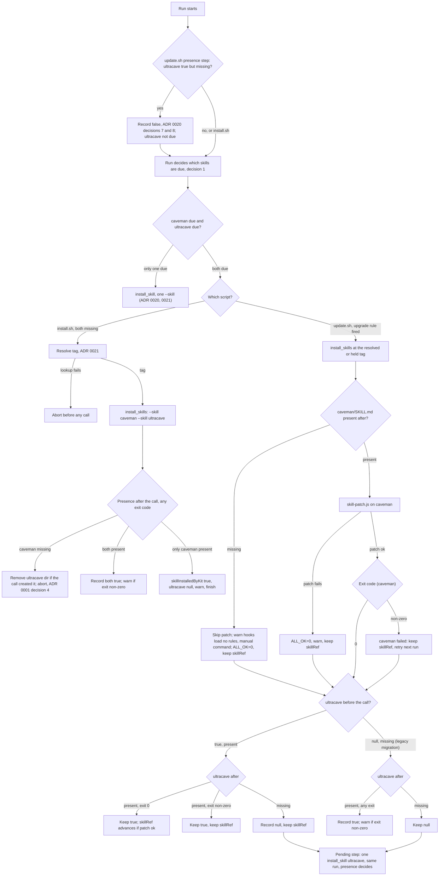

# ADR 0025: Install `caveman` and `ultracave` in one call when both are needed

**Status:** Accepted. Amends ADR 0001 decision 4 and ADR 0020 decision 6 for `caveman` (on `install.sh` a failed `caveman` call means `caveman` not present afterwards, decision 2 here), ADR 0020 decision 1 ("one call per missing skill", decision 1 here), ADR 0020 decisions 6 and 7 (how any call that installs a missing `ultracave` is judged, decision 4 here), and ADR 0021 decision 6 (upgrade of kit-owned skills, decision 3 here).

**Context:**

ADR 0020 decision 1 chose one `npx skills add` call per skill, so a failure is attributed to exactly one skill. The same decision records that a single call with repeated `--skill caveman --skill ultracave` installs both (verified 2026-10-29 with `skills` CLI v4.0.1, in a temporary `HOME`). In a fresh install, and in an upgrade that moves both kit-owned skills, the kit therefore pays for two `npx` starts and two clones where one would do.

Attribution is the only reason the calls were split. For a skill that was missing before the call, separate calls are not needed for attribution: presence afterwards shows whether the call created it (ADR 0020 decisions 1 and 6). For a skill whose old copy was present before the call, presence proves nothing, and the exit code is the only evidence. This ADR keeps that distinction explicit for every case.

**Decision:**

1. **One call when a run installs or upgrades both skills.** `lib/skills.sh` gains `install_skills <tag> <skill>...`, which runs one `npx skills add "$SKILL_REPO@<tag>" --skill <a> --skill <b> -a claude-code -g -y --copy` call. `install_skill <tag> <skill>` stays, as the one-skill case of the same helper. A call that installs or upgrades only one skill is unchanged. A run uses the combined call when both of these hold:
   - `caveman` needs installing or upgrading: it is missing on a fresh install, or the kit owns it (`skillInstalledByKit: true`) and the upgrade rule of ADR 0021 decision 5 fires: the resolved tag is higher than `skillRef`, or a held `skillRefOverride` differs from it. A resolved tag lower than `skillRef` with no override upgrades nothing, so it never triggers the combined call.
   - `ultracave` needs installing or upgrading: it is missing and not opted out (ADR 0020 decision 1 table), or the kit owns it (`true`) and the same upgrade rule fires, or it is pending (`null`) and missing. On `update.sh` the flag is read after the presence step of ADR 0020 decision 7, so a `true` here always has `ultracave` present.

   This includes the legacy migration run, where `caveman` upgrades and `ultracave` is pending in the same `update.sh` run (ADR 0021, Consequences). The pending step still runs alone when `caveman` has nothing to do.

2. **`install.sh`: presence decides, not the exit code.** Both skills are missing before the call, so presence afterwards proves the call created them. The check for `caveman` is the existing `$SKILL_PATH` test. The check for `ultracave` is `ultracave_present` (ADR 0020 decision 1). Before the call, `install.sh` records whether any entry exists at `$CLAUDE_DIR/skills/ultracave` (`[ -e "$p" ] || [ -L "$p" ]`, so a dangling symlink also counts as an entry). A partial directory counts as missing for the install decision but as an existing entry for cleanup.

   | Exit | `caveman` | `ultracave` | Result |
   |---|---|---|---|
   | 0 | present | present | `skillInstalledByKit: true`, `ultracaveInstalledByKit: true` |
   | non-zero | present | present | Same as above, plus a warning that names the non-zero exit |
   | any | missing | any | Abort (ADR 0001 decision 4). If no entry existed at `skills/ultracave` before the call and a real directory (not a symlink) exists there now, `install.sh` removes it before exiting. An entry that existed before the call is left alone |
   | any | present | missing | `skillInstalledByKit: true`, `ultracaveInstalledByKit: null`, warning with the manual command (ADR 0020 decision 6). The install finishes |

   The cleanup on abort exists because no manifest is written on that path, so `uninstall.sh` cannot remove the directory. Without it, the next `install.sh` would find `ultracave` present, record `false`, and the kit would never upgrade or remove a skill it created.

   A tag lookup failure still aborts before any call, because `caveman` is missing (ADR 0021 decision 7).

   The same presence rule applies to the single-skill `caveman` call on `install.sh` (a missing `caveman` with `ultracave` present or opted out). Today that path aborts on a non-zero exit even when `caveman` is then present. After this change it aborts only when `$SKILL_PATH` is missing after the call; a non-zero exit with `caveman` present records `skillInstalledByKit: true` and prints the same warning. So on `install.sh` the call shape never changes the outcome for the same state. This amends ADR 0020 decision 6 and ADR 0001 decision 4 for `caveman`: "a failed `caveman` call" now means "`caveman` not present after the call".

3. **`update.sh`: the state before the call decides how the result is judged.** `caveman` is kit-owned before every combined call on `update.sh`, and normally present, so its result is judged by the exit code. `ultracave` is judged by presence when it was missing before the call, and by the exit code when its old copy was present.
   - **`skill-patch.js` always runs** on `caveman` after the call when `caveman/SKILL.md` exists, whatever the exit code. A failed call may still have overwritten `caveman/SKILL.md` and dropped the ADR 0002 patch, and the patch is idempotent. A patch failure is reported as today: `ALL_OK=0`, the warning about auto-invocation, and `skillRef` stays unchanged.
   - **`caveman`:** a non-zero exit counts as a failed `caveman` upgrade. `skillRef` stays unchanged (ADR 0021 decision 6), the old copy stays in use, and the next run retries.
   - **`caveman` missing after the call** (a failed call that removed the old copy, or a kit-owned `caveman` the user had already deleted): `update.sh` skips the patch, because there is nothing to patch. It warns that `caveman` is not present after the upgrade, that the hooks load no caveman rules until it is restored, and prints `manual_skill_cmd caveman <tag>`. It sets `ALL_OK=0` and `CAVEMAN_FAILED=1`, so `skillRef` stays unchanged and the next run retries, because the upgrade rule still fires. `health_check` then repeats its existing `caveman` warning. This rule covers the single-skill `caveman` call too, so both paths report a missing `caveman` the same way.
   - **A kit-owned `caveman` missing before the call** is not judged by presence. The kit has no deletion rule for `caveman` (ADR 0020 decision 8 covers only `ultracave`), and the combined call adds none. Exit code and the missing-after rule above already hold `skillRef` whenever `caveman` is not restored. A recreated `caveman` after a non-zero exit costs one idempotent retry on the next run.
   - **`ultracave` was kit-owned and present before the call (`true`):**
     - Exit 0 and `ultracave` present: reinstalled.
     - Exit non-zero and `ultracave` present: the flag stays `true` (ADR 0020 decision 7: failed call, old copy present), and counts as a failed reinstall.
     - `ultracave` not present, whatever the exit code: the flag becomes `null`, which counts as a failed reinstall.
   - **`ultracave` was kit-owned but missing before the call (`true`, missing):** this state never reaches a combined call. The presence step of ADR 0020 decision 7 runs first, with no network, and records `false` (decision 8 there: the user deleted it). `ultracave` is then user-managed, so it is not named in `--skill`, and `caveman` takes the single-skill call. A combined call never recreates a skill the user removed.
   - **`ultracave` was pending and missing before the call (`null`, the legacy migration run):** presence decides, as in decisions 2 and 4.
     - `ultracave` present, whatever the exit code: the flag becomes `true`. A non-zero exit adds a warning that names it.
     - `ultracave` not present: the flag stays `null`.
   - **`skillRef`** advances only when the exit code is 0, the patch succeeded, and no kit-owned `ultracave` reinstall failed. A pending `ultracave` that stays `null` does not block it, because it was not a kit-owned reinstall (ADR 0021 decision 5: an advanced `skillRef` never hides the pending retry).
   - **Same-run retry.** When `ultracave` is `null` after the combined call, the pending step (ADR 0021 decision 5) runs once more in the same run, as a single-skill `install_skill` call. This holds both for a pending `ultracave` and for a kit-owned one that the call left missing. The retry is judged by presence (decision 4). It writes `skillRef` only under ADR 0021 decision 4 (when `skillRef` is `null` and no `caveman` reinstall or patch failed in the run). There is no second retry in the same run; later runs retry as before. The cost is a second clone after a failed combined call, which also gives single-skill attribution for `ultracave`.

4. **Presence decides a missing `ultracave` on every call, combined or not.** This amends ADR 0020 decisions 6 and 7 for the single-skill `ultracave` calls too: `install.sh` with a present `caveman`, and the pending step on `update.sh`. Whenever `ultracave` was missing before a call, presence afterwards (`ultracave_present`) decides its flag, and a non-zero exit only adds a warning that names it. ADR 0020's "records `true` only when the call exits 0 and `ultracave` is then present" is replaced by this rule. Without it, a call that exits non-zero after writing a complete `ultracave` leaves `null`. The next run then records `false` (ADR 0020 decision 7, `null` with `ultracave` present), and the kit never upgrades or removes a skill it created. A call that started from a present old copy is still judged by the exit code (decision 3), because presence proves nothing there.

5. **Ownership flags keep their meaning.** `skillInstalledByKit` and `ultracaveInstalledByKit` keep their values and meaning (ADR 0020 decision 2). `true` still means the kit verified `ultracave` present after its own last write. A combined call touches a skill only when its flag allows it: a user-managed skill is never named in `--skill`. A user-managed `caveman` with a missing `ultracave` takes the single-skill call, so the user's `caveman` is never reinstalled.

**Consequences:**

- A fresh install makes one `npx` call instead of two, and an upgrade of both kit-owned skills does the same. The saving is one `npx` start and one clone, so it is modest.
- The saving costs extra case logic: a four-row table for `install.sh`, two `ultracave` sub-cases and a missing-`caveman` rule on `update.sh`, a cleanup rule on abort, and a same-run retry. That logic needs its own stub tests. If it proves error-prone, the simpler fallback is the two-call path of ADR 0020 decision 1, which `install_skill` keeps available. Revert to two calls when either of these happens: a `skills` CLI release rejects or ignores a repeated `--skill` (shown by `bench/contract.js` exiting `1` at its install step, ADR 0026 decision 3), or a second bug fix lands in the combined-call case logic after it ships.
- Both fresh-install attribution and upgrade granularity change:
  - Fresh install: a non-zero exit with both skills present now counts as installed, with a warning, where two calls would have reported the failing skill. Presence is the stronger evidence, and ADR 0020 already requires it for `ultracave`.
  - Upgrade: a non-zero exit blames `caveman` and a present kit-owned `ultracave` together, although only one of them may have failed. The cost is a retry of a skill that was already current, which is idempotent.
- A single `ultracave` call that exits non-zero but leaves a complete skill now records `true` instead of `null` (decision 4). This trusts the presence check over the exit code. A CLI that exits non-zero after writing a complete `SKILL.md` but leaving other files incomplete would still be recorded `true`. This is accepted: the hook reads only `SKILL.md`.
- A failed combined call on `update.sh` that leaves `ultracave` missing is followed by a second, single-skill call in the same run. When the cause is the network, the run pays for two failing calls.
- The assumption in ADR 0020 decision 1 (later `skills` CLI versions also take repeated `--skill` and overwrite a partial directory) now carries more weight. If a later CLI refuses repeated `--skill`, both installs fail together. The fallback is to revert `install_skills` to two `install_skill` calls, which this ADR leaves in place.
- No manifest field, backup or uninstall branch changes (CLAUDE.md, Architecture section 1). The abort cleanup in decision 2 runs only on a path that writes no manifest.

**Rejected alternatives:**

- **Keep two calls.** Attribution by call is simpler to reason about, but it adds a start and a clone to every fresh install for a distinction that presence checks already give. It stays the documented fallback (Consequences).
- **Always pass both `--skill` flags, even when one skill is user-managed.** This would overwrite a skill the user manages (ADR 0001, ADR 0003), so it is rejected.
- **Judge a pending `ultracave` by the exit code, as ADR 0020 did.** It leaves `null` after a non-zero call that wrote a complete skill. The next run records `false`, and the kit loses ownership of a skill it created.
- **Leave an `ultracave` directory behind on an `install.sh` abort.** No manifest records it, so a later install would treat it as user-managed.
- **Skip the same-run retry after a combined call.** The pending step already runs after the upgrade check whenever the flag is `null` (ADR 0021 decision 5). Skipping it would need a special case, and the retry gives single-skill attribution.
