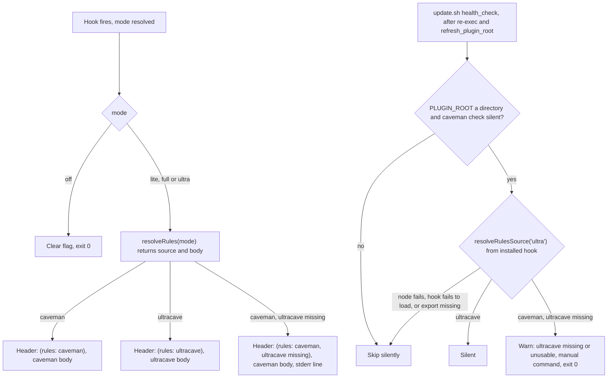
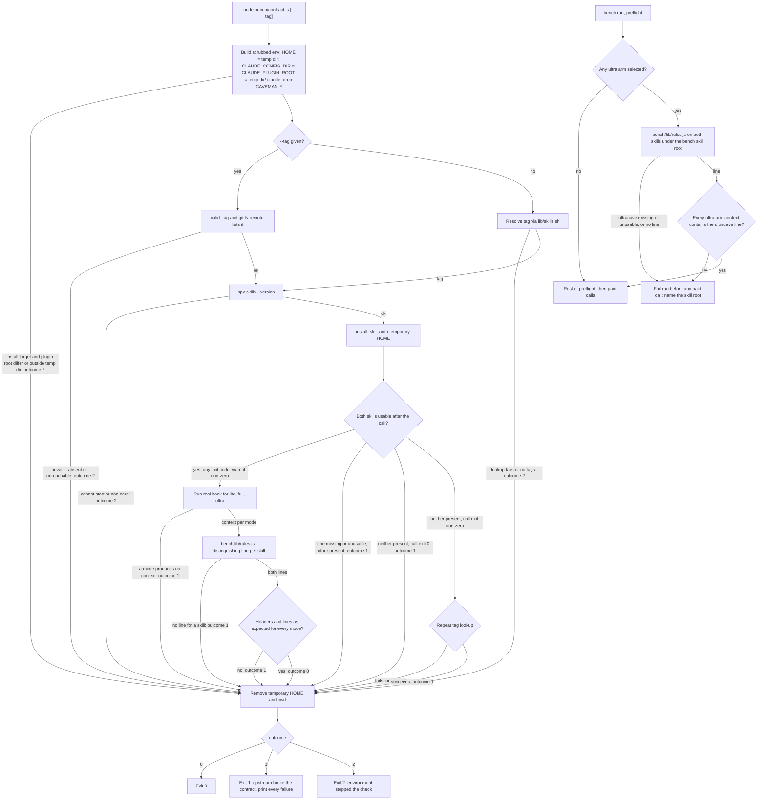

# ADR 0026: Verify which ruleset `ultra` mode actually receives

**Status:** Accepted. Amends ADR 0020 decision 5 (fallback visibility) and ADR 0008 (maintainer-only checks in `bench/`).

**Context:**

In `ultra` mode the hook injects the upstream `ultracave` body, and falls back to the caveman body when `ultracave` is missing or empty (ADR 0020 decisions 4 and 5). The fallback writes one line to stderr, which nobody sees. The model, the user and the session context all look the same in both cases. Existing checks do not close the gap:

- `tests/caveman-activate.bats` runs the hook against a fake `ultracave` fixture with `ULTRACAVE-BODY-MARKER`. It proves the wiring and cannot see an upstream rename or format change, which is how the v3.1.0 break went unnoticed (ADR 0020, Context).
- The bench preflight only checks that the injected context contains `level: ultra`. An `ultra` arm run against a fallback measures the caveman body and reports it as `ultra` (ADR 0008).
- The project runs no GitHub Actions checks because of budget limits, so every check must run locally.

**Decision:**

1. **The injected header names its rules source.** The first line becomes `CAVEMAN MODE ACTIVE — level: <mode> (rules: <source>)`, where `<source>` is one of:
   - `ultracave`: `ultra` mode, with the `ultracave` body injected.
   - `caveman`: `lite` and `full`, and any other mode that injects the caveman body.
   - `caveman, ultracave missing`: `ultra` mode that fell back (ADR 0020 decision 5). This covers every fallback cause: no readable `ultracave/SKILL.md` under either root, an empty body after frontmatter, and unterminated frontmatter (which the hook treats as empty, matching `ultracave_present`). The label says "missing" for all three, because ADR 0020 decision 1 counts an unusable file as missing.

   The suffix applies to SessionStart and SubagentStart, for every mode that injects. It does not appear in the per-turn reminder from `caveman-mode-tracker.js`, which would have to read the skill files on every prompt, nor in the statusline or desktop badge, which would add a third resolution path to the badge copies that must stay in sync (ADR 0004, ADR 0022). The existing substring checks (`CAVEMAN MODE ACTIVE — level: ultra`) still match. The stderr line stays.

2. **One helper picks both the body and the label.** `caveman-activate.js` gains `resolveRules(mode)`, which returns `{ source, body }`: `source` is one of the three `<source>` strings, and `body` is the ruleset the hook injects (the `ultracave` body, or the caveman body for `lite`, `full` and the fallback). The hook builds its header from `source` and its injected text from `body` of the same result, so the label and the body cannot disagree. The module also exports `resolveRulesSource(mode)`, a thin wrapper that returns `resolveRules(mode).source`.
   - Both functions are side-effect-free: they read skill files and nothing else. They read no flag file, write none, and print nothing. The stderr fallback line is written by the hook's main logic, not by the helper.
   - To make the module loadable for this, the main logic (stdin, flag resolution and write, injection, the stderr line) moves under `require.main === module`. Claude Code runs the hook as `node caveman-activate.js`, so behavior there does not change.

3. **`node bench/contract.js [--tag vX.Y.Z]` checks the real upstream skills.** It is maintainer-only like the rest of `bench/` (ADR 0008): `install.sh` and `update.sh` never copy it, no CI runs it, and it makes no API calls. It needs the network for the tag lookup and `npx skills add`. It separates two kinds of failure. Exit `2` means the environment stopped the check before upstream content could be judged. Exit `1` means upstream content was reached and broke the contract. A renamed, dropped or emptied skill is the break this check exists to catch, so it always exits `1`. It runs every child process (tag lookup, CLI probe, install, hook runs) in a **scrubbed environment**, built once at start: `HOME` set to the temporary dir, `CLAUDE_CONFIG_DIR` and `CLAUDE_PLUGIN_ROOT` both set to `<temporary dir>/.claude`, and every `CAVEMAN_*` variable removed. One directory then serves as the install target of `npx skills add -g`, the plugin root and the config dir, so the skills the install writes are the skills the hook reads through both of its lookups (ADR 0020 decision 4). A temporary `CLAUDE_CONFIG_DIR` is safe here although it is rejected for `health_check` (Rejected alternatives): in `contract.js` the fetched skills live under that dir, while in `health_check` the user's real skills do not. `PATH` and the proxy variables pass through. This follows the bench arm isolation (`bench/lib/isolation.js`, which already strips `CAVEMAN_*`, `CLAUDE_CONFIG_DIR` and `CLAUDE_PLUGIN_ROOT`). Without it, an exported `CLAUDE_CONFIG_DIR` would point `npx skills add -g` at the maintainer's real skills (ADR 0020 decision 4), overwriting the kit-patched `caveman/SKILL.md`, and the hook would read real skills instead of the fetched ones. Before step 1, `contract.js` asserts that `$CLAUDE_CONFIG_DIR/skills` (the install target) and `$CLAUDE_PLUGIN_ROOT/skills` are the same path under the temporary dir, and exits `2` otherwise.

   It runs these steps in order, and stops at the first step that cannot run:
   1. Take `--tag`, or resolve the tag with the shared resolver in `lib/skills.sh` (ADR 0021 decision 2), through `bash`. A failed lookup or an empty tag set exits `2`. A successful lookup proves that the upstream repository was reachable. A `--tag` value is checked the same way: it must pass `valid_tag`, and `git ls-remote --tags --refs` must list it. An invalid value or a tag absent upstream exits `2` with a message naming the tag. An unreachable remote also exits `2`. So step 3's repeat lookup always has a lookup to repeat.
   2. Probe the CLI with `npx skills --version`. A probe that cannot start or exits non-zero exits `2`, because no install has been attempted.
   3. Install both skills into a temporary `HOME` with `install_skills` (ADR 0025). The result is judged by presence, as in ADR 0025 decision 2, because both skills are missing before the call. A skill is **usable** when its `SKILL.md` is readable, its frontmatter is terminated, and its body after frontmatter is non-empty (the `ultracave_present` rule of ADR 0020 decision 1, applied to both skills).
      - Both skills usable, whatever the exit code: continue. A non-zero exit prints a warning that names it. It is not a failure, because the hook reads only `SKILL.md` (ADR 0025, Consequences).
      - A named skill missing or unusable, and at least one skill present: exit `1`. The call reached upstream, so the cause is upstream content (renamed or dropped skill, empty body, changed frontmatter). The message names each failing skill and the call's exit code.
      - Neither skill present and the call exited 0: exit `1`. The CLI ran to completion and found neither skill at the tag.
      - Neither skill present and the call exited non-zero: `contract.js` repeats the tag lookup of step 1 for the same tag. If the repeat fails, the network was lost during the run: exit `2`. If the repeat succeeds, upstream was reachable and the CLI still installed nothing: exit `1`. The message prints the tail of the call's stderr in both cases, so the maintainer can tell a dropped repository layout from a transient clone error.
   4. Run the real hook once per mode (`lite`, `full`, `ultra`), each with a fresh flag file in the temporary `HOME`, from a temporary non-git cwd. A hook that produces no context exits `1`.
   5. Derive one **distinguishing line** for each skill with `bench/lib/rules.js` (shared with decision 4): the first non-empty body line that does not occur in the other skill's body, skipping lines the hook rewrites or drops (intensity-table rows, `- <mode>:` bullets, anything matching `wenyan`). Real text is used rather than a hardcoded string, so upstream rewording does not break the check by itself. A skill with no distinguishing line is an assertion failure (exit `1`), because the check could run but upstream gives it nothing to tell the skills apart.
   6. Assert. `ultra` must produce the header `(rules: ultracave)`, contain the `ultracave` distinguishing line, and not contain the caveman one. `lite` and `full` must produce `(rules: caveman)`, contain the caveman distinguishing line, and not contain the `ultracave` one.

   Exit codes:
   - `0`: every assertion passed.
   - `1`: upstream content broke the contract. This covers a named skill missing or unusable after an install call that reached upstream (step 3), a mode with no context (step 4), a skill with no distinguishing line (step 5), and a wrong header or line (step 6). Each failure is printed. A step 3 failure stops the run, because steps 5 and 6 need both bodies. Steps 4 to 6 report every failure before exiting.
   - `2`: the environment stopped the check before upstream content could be judged. This covers a failed tag lookup or empty tag set (step 1), a CLI that cannot start (step 2), and an install that produced nothing while the repeated tag lookup also failed (step 3).

   Every exit path, including `0`, first removes the temporary `HOME` and cwd. It opens no issue.

   Stub-based tests go in `bench/tests/`, run by `bats bench/tests/` and not by `bats tests/` (CLAUDE.md, Commands). `bench/README.md` notes that this command spends no API quota. The maintainer runs it before each kit release and whenever upstream tags a new release.

4. **The bench preflight rejects a fallback `ultra` arm.** `preflight` in `bench/lib/isolation.js` uses the same derivation as `contract.js`: both call `bench/lib/rules.js`, so the two checks cannot drift apart.
   - The bench resolves `skills/ultracave/SKILL.md` where it resolves `skills/caveman/SKILL.md`, reads both bodies from that bench skill root, and derives the `ultracave` distinguishing line from them. The `CAVEMAN_BENCH_SKILL_ROOT` message says that the root needs `caveman` always, and needs `ultracave` too when any `ultra` arm is selected.
   - For every arm with mode `ultra` (`ultra` and `ultra-no-focus`), the injected context must contain that line. Otherwise the run fails before any paid call.
   - The run also fails before any paid call when `ultracave/SKILL.md` is missing or unusable under the skill root, or when `bench/lib/rules.js` finds no distinguishing line. The error names the skill root it searched.
   - Arms without an `ultra` mode do not need `ultracave`, but the run still derives the line once per run whenever any `ultra` arm is selected.

   After the changes ship, the maintainer runs one `ultra` against `full` comparison by hand (`bench/README.md`). It is a sanity check, not a ship gate: ADR 0020 decision 9 already ruled out a gate for unmodified upstream text. No new behavioral eval is added.

5. **`update.sh`'s `health_check` warns when `ultra` would fall back.** After its existing `caveman` check it runs `resolveRulesSource('ultra')` from the installed hook (`$KIT_HOME/hooks/caveman-activate.js`) with `CLAUDE_PLUGIN_ROOT` set to the manifest `pluginRoot`. Because of decision 2, this reads no flag file and does not change the user's saved mode, which a forced-`ultra` run of the real hook would. If the result is `caveman, ultracave missing`, it prints a warning that `ultracave` is missing or unusable (no readable `SKILL.md`, an empty body, or unterminated frontmatter), that `ultra` uses the caveman rules, and the command `manual_skill_cmd ultracave <tag>`, pinned as in ADR 0021 decision 7 (resolved or held tag, else `skillRef`, else the placeholder). It never changes the exit code.
   - `health_check` runs in the pulled `update.sh`, after the ADR 0021 decision 5 re-exec, so the installed hook is the copy the kit step just wrote.
   - The root it passes is `$PLUGIN_ROOT` as `health_check` already uses it: the manifest `pluginRoot`, replaced by the re-resolved root when `refresh_plugin_root` detected drift. An empty or absent manifest `pluginRoot` never reaches `health_check`, because `update.sh` already stops with "pluginRoot not in manifest".
   - It skips silently when `node` fails, when the installed hook fails to load (for example, a hand-edited or truncated copy), or when the hook lacks the export (for example, a hooks directory restored by hand from an older backup). The check is diagnostic, so it must never fail the update.
   - It also skips when `$PLUGIN_ROOT` is not an existing directory, or when the existing `caveman` check has just warned. In both cases the hooks load no rules at all, and the `caveman` warning already names the fix. An `ultracave` warning there would point at the wrong skill.

**Consequences:**

- A fallback is visible in three places: the session context, `update.sh` output, and the bench preflight. Before this change it was visible in none of them.
- `bench/contract.js` is the only check against real upstream text. Because no CI runs it, drift is caught only when the maintainer runs it. Skipping a run before a release leaves the v3.1.0 failure mode open.
- The exit split errs toward `1`. A clone that fails transiently while the repeated tag lookup succeeds reports `1`, not `2`. The printed stderr tail shows the cause, and a rerun clears it. The opposite error, an upstream break reported as "could not run", is the one this check must not make.
- A user who deliberately runs without `ultracave` (`--no-install-skill`, ADR 0020 decision 1) gets the `update.sh` warning on every run. The manifest does not record the opt-out, so the kit cannot tell them apart from a user who needs the warning (ADR 0020 decision 7, legacy manifests). The warning states the condition and the manual command.
- The `update.sh` change takes effect on the first run that pulls it: the kit step re-execs the pulled `update.sh` (ADR 0021 decision 5), and `health_check` runs in that copy against the hooks it just copied.
- The header gains a suffix, so the injected text grows by about a dozen tokens per session start. The per-turn reminder is unchanged.
- The hook module is loadable without side effects. Any future hook export must keep that property.
- The distinguishing-line rule lives in one module, `bench/lib/rules.js`. A change to what the hook rewrites or drops must update its skip list, or both `contract.js` and the preflight may pick a line the hook never injects.
- Documentation of the new command (`bench/README.md`, CLAUDE.md Commands) is part of the implementation tickets.

**Rejected alternatives:**

- **Scheduled GitHub Actions job against upstream.** The project does not use GitHub Actions checks (budget limits).
- **Run the real hook with the mode forced to `ultra` in `health_check`.** The hook writes the resolved mode to the flag file, which would change a `full` user's saved mode to `ultra` in whatever repo `update.sh` ran from.
- **Run the hook against a temporary `CLAUDE_CONFIG_DIR` in `health_check`.** It would break the hook's second `ultracave` lookup under `${CLAUDE_CONFIG_DIR}/skills` (ADR 0020 decision 4) and could report a present skill as missing.
- **Exit `2` for any skill missing after the install.** A renamed, dropped or emptied upstream skill is the break the check exists to catch. Reporting it as "could not run" would let the maintainer read a v3.1.0-style break as a network problem.
- **Exit `2` for any non-zero install exit.** ADR 0025 decision 2 already judges a call that started from missing skills by presence. A non-zero exit with both skills usable leaves nothing for the hook to miss, so it is a warning.
- **A new paid behavioral eval.** The existing `ultra` against `bare` token comparison already shows whether the stricter rules take effect.
- **Separate label and body lookups in the hook.** Two reads of the skill files could reach different results (for example, a file replaced between them), so the header could name a source whose body was not injected.
